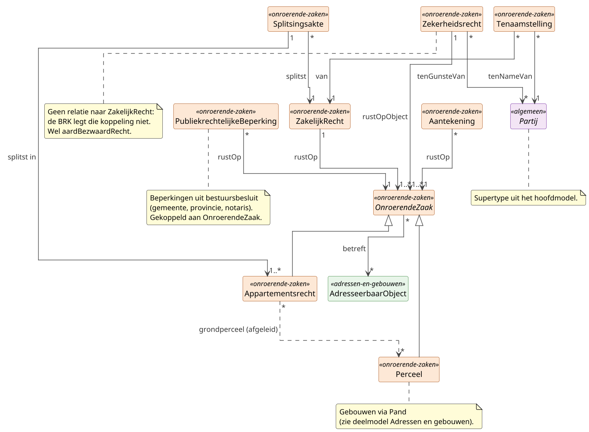

# Deelmodel: Onroerende zaken

Onroerende zaken en de zakelijke rechten daarop. Inclusief
hypotheek/beslag (`Zekerheidsrecht`), kwalitatieve verplichtingen
(`Aantekening`) en publiekrechtelijke beperkingen.

WOZ-waarde valt buiten dit deelmodel; zie
[Waarde onroerende zaken](waarde-onroerende-zaken.md). Geometrische
projecties van percelen (BRK-geometrie) vallen eveneens buiten dit
deelmodel.

!!! info "Herzien na review door het Kadaster (2026-08-28)"

    Dit deelmodel is herzien naar aanleiding van een review door het
    Data Management Modellenbureau van het Kadaster. De belangrijkste
    wijzigingen: `KadastraleOnroerendeZaak` heet nu `OnroerendeZaak`
    (KOZ was RSGB-terminologie), `Appartementsrechtsplitsing` heet nu
    `Splitsingsakte` en verwijst naar het gesplitste zakelijk recht in
    plaats van naar een perceel, `KadastraleAanduiding` is een
    gestructureerd datatype geworden, de relatienamen volgen het
    CDMKAD (`rustOp`, `van`, `tenNameVan`), en de definities van
    `Aantekening`, `Perceel`, `Appartementsrecht` en `OnroerendeZaak`
    zijn letterlijk uit de BRK-catalogus overgenomen in plaats van in
    eigen woorden geherformuleerd.

## Diagram

## Objecttypen

### Aantekening

**Definitie**: Een aanvulling op de registratie van een registergoed
met betrekking tot feiten die gevolgen kunnen hebben voor de
uitoefening van de rechten op dit registergoed.

**Herkomst definitie**: Letterlijk overgenomen uit de
[BRK-catalogus, begrip Aantekening](https://catalogus.kadaster.nl/brk/nl/page/Aantekening).
Wettelijke grondslag: Kadasterwet art. 8. Aanvullend voor de
kwalitatieve verplichting: Burgerlijk Wetboek Boek 6.

**Toelichting**: De definitie is die van de BRK en wordt letterlijk
overgenomen; GBO herdefinieert het begrip niet. Tot 2026-08-28
hanteerde GBO een engere eigen definitie (privaatrechtelijke
vermelding, kwalitatieve verplichting of bewindstelling); die is
teruggebracht tot een scope-notitie.

**Scope**: de BRK onderscheidt aantekeningen op de tenaamstelling, op
het object, op een publiekrechtelijke beperking en op een
zekerheidsstelling; de waardelijst
[AardAantekening](https://developer.kadaster.nl/schemas/waardelijsten/AardAantekening/)
telt honderden soorten. Voor GBO liggen de privaatrechtelijke
aantekeningen bij het object voorop (kwalitatieve verplichting,
bewindstelling); de overige soorten worden niet uitgesloten maar zijn
niet apart uitgewerkt.

Aantekening is de privaatrechtelijke tegenhanger van
`PubliekrechtelijkeBeperking`: beide kunnen tegelijk op dezelfde
onroerende zaak rusten. Een aantekening ontstaat uit een notariële
handeling, niet uit een bestuursbesluit.

| MIM-veld | Waarde |
|---|---|
| Naam | Aantekening |
| Begrip (URI) | `https://begrippen.gbo-semantiek.nl/id/begrip/Aantekening` |
| Herkomst | BRK (basisregistratie) |
| Datum opname | 2026-04-28 |
| Datum wijziging | 2026-08-28 |
| Unieke aanduiding | identificatie |
| Populatie | Alle aantekeningen die op grond van de Kadasterwet bij een registergoed in de BRK zijn geregistreerd. |

**Attribuutsoorten**:

| Naam | Type | Kard. | Authentiek | Mat. hist. | Form. hist. | Definitie | Herkomst | Toelichting |
|---|---|---|---|---|---|---|---|---|
| aardAantekening | [Codelijst](../datatypes-en-codelijsten.md#aanvullende-datatypes) | 1 | Basisgegeven | Ja | Ja | Aard van de aantekening, bijvoorbeeld kwalitatieve verplichting of bewindstelling. | BRK-Catalogus | Waardelijst [AardAantekening](https://developer.kadaster.nl/schemas/waardelijsten/AardAantekening/) van het Kadaster, extern beheerd. |
| omschrijving | [CharacterString](../datatypes-en-codelijsten.md#simpele-datatypes) | 0..1 | Basisgegeven | Ja | Ja | Korte vrije omschrijving van de inhoud van de aantekening. | BRK-Catalogus | |
| datumIngang | [Datum](../datatypes-en-codelijsten.md#simpele-datatypes) | 1 | Basisgegeven | Ja | Ja | Datum waarop de aantekening van kracht is geworden. | BRK-Catalogus | |
| voorkomen | Voorkomen | 1 | Basisgegeven | Ja | Ja | Bitemporele markering van werkelijke en registratie-tijdlijn. | GBO (mixin) | Zie patroon Voorkomen-mixin in [Patronen](../hoofdmodel.md#voorkomen-mixin-bitemporaliteit). |

**Relatiesoorten** (uitgaand):

| Naam | Doel | Kard. (bron→doel) | Authentiek | Mat. hist. | Form. hist. | Toelichting |
|---|---|---|---|---|---|---|
| rustOp | OnroerendeZaak | * → 1 | Basisgegeven | Ja | Ja | Onroerende zaak waarop de aantekening rust. |

### Appartementsrecht

**Definitie**: Een aandeel in bij een splitsing betrokken goederen dat
de bevoegdheid omvat tot het uitsluitend gebruik van bepaalde
gedeelten van een gebouw die blijkens hun inrichting bestemd zijn of
worden om als afzonderlijk geheel te worden gebruikt; geregistreerd in
de Basisregistratie Kadaster als onroerende zaak.

**Herkomst definitie**: Letterlijk overgenomen uit de
[BRK-catalogus, begrip Appartementsrecht](https://catalogus.kadaster.nl/brk/nl/page/Appartementsrecht).
Wettelijke grondslag: Burgerlijk Wetboek Boek 5 titel 9 (art. 106
e.v.); Kadasterwet; IMKAD/CDMKAD.

**Toelichting**: Appartementsrecht is het juridische eigendomsobject
voor flatgebouwen, gedeelde-grond-woningcomplexen en
bedrijfsverzamelgebouwen. Bewoners zijn eigenaar van het recht, niet
van de onderliggende grond, die in mede-eigendom is. Een
appartementsrecht ontstaat uit een notariële splitsingsakte
(`Splitsingsakte`) waarbij een zakelijk recht op één of meer
onroerende zaken in appartementsrechten wordt gesplitst. Het
juridische begrip *appartementsrecht* komt ook voor als waarde van
`AardZakelijkRecht`; GBO neemt het kadastrale object hier op omdat BRK
het zo registreert.

Tot 2026-08-28 kende dit objecttype een eigen attribuut
`indexnummer`; dat is het `appartementsrechtVolgnummer` binnen het
gestructureerde datatype `KadastraleAanduiding`.

Tot 2026-09-28 stond de relatie `betreft` naar `AdresseerbaarObject`
alleen op dit objecttype. Zij staat nu op `OnroerendeZaak`, zodat ook
een adres in een niet gesplitst pand naar zijn perceel te herleiden is.

| MIM-veld | Waarde |
|---|---|
| Naam | Appartementsrecht |
| Begrip (URI) | `https://begrippen.gbo-semantiek.nl/id/begrip/Appartementsrecht` |
| Herkomst | BRK (basisregistratie) |
| Datum opname | 2026-04-28 |
| Datum wijziging | 2026-09-28 |
| Unieke aanduiding | kadastraleAanduiding (inclusief appartementsrechtVolgnummer) |
| Populatie | Alle appartementsrechten die in Nederland door notariële splitsingsakte zijn ontstaan en als onroerende zaak in de BRK zijn geregistreerd. |

**Attribuutsoorten**: geen eigen attribuutsoorten; `identificatie`,
`kadastraleAanduiding`, `soortGrootte` en `onroerendeZaakStatus` zijn
geërfd van `OnroerendeZaak`.

**Relatiesoorten** (uitgaand):

| Naam | Doel | Kard. (bron→doel) | Authentiek | Mat. hist. | Form. hist. | Toelichting |
|---|---|---|---|---|---|---|
| grondperceel | Perceel | * → * | Afgeleid | Ja | Ja | Perceel of percelen waarop het appartementsrecht betrekking heeft, afgeleid via de splitsing. Bij een ondersplitsing loopt de weg naar het grondperceel via het bovenliggende appartementsrecht. |

De relatie `betreft` naar `AdresseerbaarObject` is geërfd van
`OnroerendeZaak`.

### OnroerendeZaak

**Definitie**: De grond, de niet gewonnen delfstoffen, de met de grond
verenigde beplantingen, alsmede de gebouwen en werken die duurzaam met
de grond zijn verenigd, hetzij rechtstreeks, hetzij door vereniging
met andere gebouwen of werken.

**Herkomst definitie**: Letterlijk overgenomen uit de
[BRK-catalogus, begrip OnroerendeZaak](https://catalogus.kadaster.nl/brk/nl/page/OnroerendeZaak).
Wettelijke grondslag: Burgerlijk Wetboek Boek 3 art. 3; Kadasterwet
art. 1; IMKAD/CDMKAD.

**Toelichting**: Abstract supertype dat de gemeenschappelijke kenmerken
en relaties van `Perceel` en `Appartementsrecht` bundelt. Zakelijke
rechten, zekerheidsrechten, aantekeningen en publiekrechtelijke
beperkingen worden via dit supertype gekoppeld zodat zij even goed op
een perceel als op een appartementsrecht kunnen rusten.

Tot 2026-08-28 heette dit objecttype `KadastraleOnroerendeZaak`, met
afkorting KOZ. Die naam en die afkorting komen uit het RSGB, niet uit
de BRK; het Kadaster kent het objecttype als `OnroerendeZaak`. Beide
oude namen blijven als alias staan.

De adreskoppeling (`betreft`) staat op dit supertype omdat de BRK
adressen aan de onroerende zaak koppelt, aan een perceel even goed als
aan een appartementsrecht. HC-BRK zoekt `kadastraalonroerendezaken` op
postcode, huisnummer, huisletter, huisnummertoevoeging en
`nummeraanduidingIdentificatie`, voor beide soorten. Een adres in een
gesplitst gebouw leidt zo naar het appartementsrecht, een adres in een
niet gesplitst pand naar het perceel.

!!! note "Openstaand punt"

    GBO beperkt de populatie feitelijk tot kadastraal geregistreerde
    onroerende zaken, terwijl de overgenomen definitie ruimer is.
    Netwerken en werken van algemeen belang zijn juridisch eveneens
    onroerende zaken. Of zij binnen scope komen is een openstaand
    besluit.

| MIM-veld | Waarde |
|---|---|
| Naam | OnroerendeZaak |
| Alias | KadastraleOnroerendeZaak, KOZ (beide RSGB) |
| Begrip (URI) | `https://begrippen.gbo-semantiek.nl/id/begrip/OnroerendeZaak` |
| Herkomst | BRK (basisregistratie) |
| Datum opname | 2026-04-28 |
| Datum wijziging | 2026-09-28 |
| Indicatie abstract object | Ja |
| Unieke aanduiding | identificatie |
| Populatie | Binnen GBO: alle kadastraal afgebakende objecten (percelen en appartementsrechten) in Nederland zoals geregistreerd in de BRK door het Kadaster. Netwerken en werken van algemeen belang zijn juridisch eveneens onroerende zaken maar zijn in GBO vooralsnog niet uitgewerkt. |

**Attribuutsoorten**:

| Naam | Type | Kard. | Authentiek | Mat. hist. | Form. hist. | Definitie | Herkomst | Toelichting |
|---|---|---|---|---|---|---|---|---|
| **`identificatie`** | [NEN3610ID](../datatypes-en-codelijsten.md#aanvullende-datatypes) | 1 | Authentiek | Ja | Ja | Objectidentificatie volgens NEN 3610. | BRK-Catalogus | Stabiel identificerend over de levensloop heen. |
| kadastraleAanduiding | [KadastraleAanduiding](../datatypes-en-codelijsten.md#aanvullende-datatypes) | 1 | Authentiek | Ja | Ja | De unieke aanduiding van een onroerende zaak die door het Kadaster is vastgesteld. | BRK-Catalogus | Gestructureerd datatype met `kadastraleGemeente`, `sectie`, `perceelnummer` en `appartementsrechtVolgnummer`. |
| soortGrootte | [`SoortGrootte`](#soortgrootte) | 1 | Authentiek | Ja | Ja | Kwaliteit van de geometrische afbakening. | BRK-Catalogus | Zie enumeratie SoortGrootte. |
| onroerendeZaakStatus | [`OnroerendeZaakStatus`](#onroerendezaakstatus) | 1 | Authentiek | Ja | Ja | Levensfase-status van de onroerende zaak. | BRK-Catalogus | Zie enumeratie OnroerendeZaakStatus. |
| voorkomen | Voorkomen | 1 | Basisgegeven | Ja | Ja | Bitemporele markering van werkelijke en registratie-tijdlijn. | GBO (mixin) | Zie patroon Voorkomen-mixin in [Patronen](../hoofdmodel.md#voorkomen-mixin-bitemporaliteit). |

**Relatiesoorten** (uitgaand):

| Naam | Doel | Kard. (bron→doel) | Authentiek | Mat. hist. | Form. hist. | Toelichting |
|---|---|---|---|---|---|---|
| betreft | AdresseerbaarObject | * → * | Basisgegeven | Ja | Ja | Adresseerbare objecten (verblijfsobject, standplaats of ligplaats) die aan de onroerende zaak zijn gekoppeld. Meervoudig in beide richtingen: een perceel met een pand met meerdere verblijfsobjecten draagt meerdere adresseerbare objecten, en een verblijfsobject dat over twee percelen ligt hoort bij beide. Tot 2026-09-28 stond deze relatie alleen op `Appartementsrecht` (`0..1 → 0..1`). |

!!! note "Openstaand punt"

    Of de BRK bij een gesplitst gebouw het adres alleen aan het
    appartementsrecht koppelt of ook aan het grondperceel, moet het
    Kadaster bevestigen. Bij een gesplitst gebouw bepaalt het
    appartementsrecht de rechthebbende.

### Perceel

**Definitie**: Een begrensd deel van het Nederlands grondgebied dat
kadastraal geïdentificeerd is en met kadastrale grenzen begrensd is.

**Herkomst definitie**: Letterlijk overgenomen uit de
[BRK-catalogus, begrip Perceel](https://catalogus.kadaster.nl/brk/nl/page/Perceel).
Wettelijke grondslag: Kadasterwet art. 1; IMKAD/CDMKAD.

**Toelichting**: Perceel beschrijft de kadastraal-juridische
werkelijkheid: een afgebakend stuk grond als registratie-eenheid, los
van de fysieke bebouwing (Pand in BAG) en los van de fiscale
waardering (WOZ-object). Een perceel kan onbebouwd zijn, één pand
dragen, of door meerdere panden gedeeltelijk worden bedekt; een pand
kan over meerdere percelen liggen.

Tot 2026-08-28 hanteerde GBO een eigen definitie en stonden
`kadastraleGemeente`, `sectie` en `perceelnummer` als losse attributen
op `Perceel`. Dat waren de componenten van de kadastrale aanduiding;
zij staan nu in het gestructureerde datatype `KadastraleAanduiding`.

| MIM-veld | Waarde |
|---|---|
| Naam | Perceel |
| Alias | Kadastraal perceel (BRK-LO volledige naam) |
| Begrip (URI) | `https://begrippen.gbo-semantiek.nl/id/begrip/Perceel` |
| Herkomst | BRK (basisregistratie) |
| Datum opname | 2026-04-28 |
| Datum wijziging | 2026-08-28 |
| Unieke aanduiding | kadastraleAanduiding |
| Populatie | Alle kadastraal afgebakende stukken grond in Nederland zoals geregistreerd in de BRK door het Kadaster, inclusief actuele en historische percelen. |

**Attribuutsoorten** (eigen attribuutsoorten; `identificatie`,
`kadastraleAanduiding`, `soortGrootte` en `onroerendeZaakStatus` zijn
geërfd van `OnroerendeZaak`):

| Naam | Type | Kard. | Authentiek | Mat. hist. | Form. hist. | Definitie | Herkomst | Toelichting |
|---|---|---|---|---|---|---|---|---|
| oppervlakte | [Numeriek](../datatypes-en-codelijsten.md#simpele-datatypes) | 0..1 | Authentiek | Ja | Ja | Kadastrale oppervlakte in vierkante meters. | BRK-Catalogus | HC-naam: `grootte`. |

**Relatiesoorten** (uitgaand): geen eigen uitgaande relaties.

### PubliekrechtelijkeBeperking

**Definitie**: Een beperking van het gebruiksrecht op een kadastraal
onroerende zaak die voortvloeit uit een publiekrechtelijk besluit van
een bestuursorgaan en die op grond van de Wet kenbaarheid
publiekrechtelijke beperkingen kenbaar wordt gemaakt via de
Basisregistratie Kadaster.

**Herkomst definitie**: Wet kenbaarheid publiekrechtelijke beperkingen
onroerende zaken (Wkpb) art. 1; Kadasterwet; BRK-Catalogus
(objecttype `PubliekrechtelijkeBeperking`).

**Toelichting**: Eigen registratie binnen de Kadasterwet, los van het
zakelijk-recht-cluster. Beperkingen worden opgelegd door de overheid
(gemeente, provincie, Rijk) zonder instemming van de eigenaar, in
tegenstelling tot privaatrechtelijke aantekeningen die uit notariële
handelingen voortvloeien. Eén besluit kan meerdere kadastrale
onroerende zaken raken: in dat geval ontstaan meerdere registraties
die naar hetzelfde brondocument verwijzen.

| MIM-veld | Waarde |
|---|---|
| Naam | PubliekrechtelijkeBeperking |
| Alias | BRK-PB |
| Begrip (URI) | `https://begrippen.gbo-semantiek.nl/id/begrip/PubliekrechtelijkeBeperking` |
| Herkomst | BRK (basisregistratie) |
| Datum opname | 2026-04-28 |
| Unieke aanduiding | identificatie |
| Populatie | Alle door bestuursorganen opgelegde publiekrechtelijke beperkingen die op grond van de Wkpb in de BRK worden geregistreerd (monumentenstatus, voorkeursrecht, onteigening, archeologische bescherming, bodemsanering-plicht en dergelijke). |

**Attribuutsoorten**:

| Naam | Type | Kard. | Authentiek | Mat. hist. | Form. hist. | Definitie | Herkomst | Toelichting |
|---|---|---|---|---|---|---|---|---|
| **`identificatie`** | [NEN3610ID](../datatypes-en-codelijsten.md#aanvullende-datatypes) | 1 | Authentiek | Ja | Ja | Unieke beperking-identificatie volgens NEN 3610. | BRK-Catalogus | |
| typeBeperking | [`TypePubliekrechtelijkeBeperking`](#typepubliekrechtelijkebeperking) | 1 | Authentiek | Ja | Ja | Type van de publiekrechtelijke beperking. | BRK-Catalogus | Zie enumeratie TypePubliekrechtelijkeBeperking. |
| omschrijving | [CharacterString](../datatypes-en-codelijsten.md#simpele-datatypes) | 0..1 | Basisgegeven | Ja | Ja | Korte vrije omschrijving van de beperking. | BRK-Catalogus | |
| grondslag | [CharacterString](../datatypes-en-codelijsten.md#simpele-datatypes) | 1 | Authentiek | Ja | Ja | Wettelijke grondslag (artikel + wet). | BRK-Catalogus | |
| datumIngang | [Datum](../datatypes-en-codelijsten.md#simpele-datatypes) | 1 | Authentiek | Ja | Ja | Datum waarop de beperking is ingegaan. | BRK-Catalogus | |
| datumEinde | [Datum](../datatypes-en-codelijsten.md#simpele-datatypes) | 0..1 | Basisgegeven | Ja | Ja | Datum waarop de beperking is beëindigd. | BRK-Catalogus | Leeg betekent lopend. |
| documentdatum | [Datum](../datatypes-en-codelijsten.md#simpele-datatypes) | 1 | Authentiek | Ja | Ja | Datum van het brondocument (bestuursbesluit). | BRK-Catalogus | |
| documentnummer | [Identificatie](../datatypes-en-codelijsten.md#simpele-datatypes) | 1 | Authentiek | Ja | Ja | Identificatie van het brondocument. | BRK-Catalogus | |
| voorkomen | Voorkomen | 1 | Basisgegeven | Ja | Ja | Bitemporele markering van werkelijke en registratie-tijdlijn. | GBO (mixin) | Zie patroon Voorkomen-mixin in [Patronen](../hoofdmodel.md#voorkomen-mixin-bitemporaliteit). |

**Relatiesoorten** (uitgaand):

| Naam | Doel | Kard. (bron→doel) | Authentiek | Mat. hist. | Form. hist. | Toelichting |
|---|---|---|---|---|---|---|
| rustOp | OnroerendeZaak | * → 1 | Authentiek | Ja | Ja | Onroerende zaak waarop de beperking rust. |

### Splitsingsakte

**Definitie**: De notariële akte waarbij een zakelijk recht op één of
meer onroerende zaken wordt gesplitst in appartementsrechten, met
vermelding van de verdeling en de aandelen in de gemeenschap.

**Herkomst definitie**: Burgerlijk Wetboek Boek 5 titel 9 (art. 106
e.v., splitsing in appartementsrechten); Kadasterwet. In de BRK is dit
een stukdeel met
[AardStukdeel](https://developer.kadaster.nl/schemas/waardelijsten/AardStukdeel/)
616 (splitsing in appartementsrechten) of 617 (ondersplitsing).

**Toelichting**: Dit objecttype heette tot 2026-08-28
`Appartementsrechtsplitsing`. Die naam botst met het BRK-begrip
[AppartementsrechtSplitsing](https://catalogus.kadaster.nl/brk/nl/page/AppartementsrechtSplitsing),
dat geen akte is maar het in appartementsrechten gesplitste zakelijk
recht zelf. Wat GBO hier modelleert is de akte.

Gesplitst wordt een recht, niet een perceel, en dat recht is niet
noodzakelijk eigendom: ook erfpacht of opstal kan in
appartementsrechten worden gesplitst. Tot 2026-08-28 verwees dit
objecttype rechtstreeks naar `Perceel`; dat is vervangen door een
verwijzing naar het gesplitste zakelijk recht.

Twee vormen: hoofdsplitsing (van een recht op één of meer percelen) en
ondersplitsing (van een recht op een bestaand appartementsrecht). De
onderliggende onroerende zaken volgen uit `ZakelijkRecht.rustOp`.

De splitsingsakte is een eenmalige rechtshandeling die het ontstaan
van de appartementsrechten vastlegt. Het akte-object zelf kent geen
levensloop met materiële of formele historie; nieuwe of gewijzigde
rechtssituaties leiden tot nieuwe akten met eigen identificatie.

| MIM-veld | Waarde |
|---|---|
| Naam | Splitsingsakte |
| Alias | Akte van splitsing |
| Begrip (URI) | `https://begrippen.gbo-semantiek.nl/id/begrip/Splitsingsakte` |
| Herkomst | BRK (basisregistratie) |
| Datum opname | 2026-04-28 |
| Datum wijziging | 2026-08-28 |
| Unieke aanduiding | documentnummer |
| Populatie | Alle in Nederland verleden notariële akten van splitsing in appartementsrechten, hoofdsplitsing zowel als ondersplitsing. |

**Attribuutsoorten**:

| Naam | Type | Kard. | Authentiek | Mat. hist. | Form. hist. | Definitie | Herkomst | Toelichting |
|---|---|---|---|---|---|---|---|---|
| akteverwijzing | [CharacterString](../datatypes-en-codelijsten.md#simpele-datatypes) | 1 | Authentiek | Nee | Nee | Verwijzing naar de notariële splitsingsakte. | BRK-Catalogus | |
| datumSplitsing | [Datum](../datatypes-en-codelijsten.md#simpele-datatypes) | 1 | Authentiek | Nee | Nee | Datum waarop de splitsing rechtsgeldig is geworden. | BRK-Catalogus | |
| documentdatum | [Datum](../datatypes-en-codelijsten.md#simpele-datatypes) | 1 | Authentiek | Nee | Nee | Datum van het verlijden van de splitsingsakte. | BRK-Catalogus | |
| **`documentnummer`** | [Identificatie](../datatypes-en-codelijsten.md#simpele-datatypes) | 1 | Authentiek | Nee | Nee | Identificatie van de splitsingsakte. | BRK-Catalogus | |

**Relatiesoorten** (uitgaand):

| Naam | Doel | Kard. (bron→doel) | Authentiek | Mat. hist. | Form. hist. | Toelichting |
|---|---|---|---|---|---|---|
| splitstIn | Appartementsrecht | 1 → 1..* | Authentiek | Nee | Nee | Appartementsrechten die door de splitsing ontstaan. |
| splitst | ZakelijkRecht | * → 1 | Authentiek | Nee | Nee | Het zakelijk recht dat door de akte in appartementsrechten wordt gesplitst; eigendom, maar ook erfpacht of opstal. |

### Tenaamstelling

**Definitie**: De geregistreerde rechtsbetrekking tussen een
rechthebbende partij en een zakelijk recht op een kadastraal
onroerende zaak, met vermelding van het aandeel waarmee de partij in
het recht deelneemt.

**Herkomst definitie**: Kadasterwet; Burgerlijk Wetboek Boek 3
(registergoederen, mede-eigendom art. 166 e.v.); BRK-Catalogus
(associatieklasse `Tenaamstelling`).

**Toelichting**: Tenaamstelling is een verbinding met eigen kenmerken
tussen `Partij` en `ZakelijkRecht`. Meervoudige eigendomsverhoudingen
worden expliciet gemodelleerd: een echtpaar in gemeenschap van
goederen krijgt twee tenaamstellingen met `gezamenlijkAandeel = ja`,
mede-eigendom van een vakantiehuis krijgt meerdere tenaamstellingen
met elk een breuk-aandeel, en erfopvolging leidt tot een nieuwe
tenaamstelling met latere `datumIngang` terwijl de oude een
`datumEinde` krijgt. De Haal-Centraal-API consolideert
`Tenaamstelling × ZakelijkRecht × Partij` tot één
`ZakelijkGerechtigde`-resource; GBO houdt de drie zaken gescheiden
omdat dat rijker is voor historie en meervoudige tenaamstelling.

| MIM-veld | Waarde |
|---|---|
| Naam | Tenaamstelling |
| MIM-element | Relatieklasse |
| Begrip (URI) | `https://begrippen.gbo-semantiek.nl/id/begrip/Tenaamstelling` |
| Herkomst | BRK (basisregistratie) |
| Datum opname | 2026-04-28 |
| Unieke aanduiding | Samengesteld uit (Partij, ZakelijkRecht, datumIngang) |
| Populatie | Alle in de BRK geregistreerde tenaamstellingen, historisch en actueel, die een rechthebbende koppelen aan een zakelijk recht op een onroerende zaak. |

**Attribuutsoorten**:

| Naam | Type | Kard. | Authentiek | Mat. hist. | Form. hist. | Definitie | Herkomst | Toelichting |
|---|---|---|---|---|---|---|---|---|
| aandeel | [Breuk](../datatypes-en-codelijsten.md#aanvullende-datatypes) | 1 | Authentiek | Ja | Ja | Aandeel van de partij in het zakelijk recht, uitgedrukt als breuk. | BRK-Catalogus | Bijvoorbeeld 1/2, 1/3, 1/1. |
| gezamenlijkAandeel | [Indicatie](../datatypes-en-codelijsten.md#simpele-datatypes) | 0..1 | Authentiek | Ja | Ja | Markeert mede-eigendom met gemeenschappelijk aandeel (zoals een echtpaar in gemeenschap van goederen). | BRK-Catalogus | |
| datumIngang | [Datum](../datatypes-en-codelijsten.md#simpele-datatypes) | 1 | Authentiek | Ja | Ja | Datum waarop de tenaamstelling is ingegaan. | BRK-Catalogus | |
| datumEinde | [Datum](../datatypes-en-codelijsten.md#simpele-datatypes) | 0..1 | Authentiek | Ja | Ja | Datum waarop de tenaamstelling is geëindigd. | BRK-Catalogus | Leeg betekent lopend. |
| voorkomen | Voorkomen | 1 | Basisgegeven | Ja | Ja | Bitemporele markering van werkelijke en registratie-tijdlijn. | GBO (mixin) | Zie patroon Voorkomen-mixin in [Patronen](../hoofdmodel.md#voorkomen-mixin-bitemporaliteit). |

**Relatiesoorten** (uitgaand):

| Naam | Doel | Kard. (bron→doel) | Authentiek | Mat. hist. | Form. hist. | Toelichting |
|---|---|---|---|---|---|---|
| tenNameVan | Partij | * → 1 | Authentiek | Ja | Ja | Rechthebbende partij. |
| van | ZakelijkRecht | * → 1 | Authentiek | Ja | Ja | Zakelijk recht waarvoor de tenaamstelling geldt. |

### ZakelijkRecht

**Definitie**: Een vermogensrecht op een zaak dat tegen iedereen kan
worden uitgeoefend en dat in de Basisregistratie Kadaster wordt
geregistreerd; voorbeelden zijn eigendom, erfpacht, opstal en
vruchtgebruik.

**Herkomst definitie**: Burgerlijk Wetboek Boek 5 (zakelijke rechten,
art. 1 e.v., art. 85 t/m 105); Burgerlijk Wetboek Boek 3
(registergoederen, art. 10 e.v.); Kadasterwet; BRK-Catalogus
(objecttype `ZakelijkRecht`).

**Toelichting**: ZakelijkRecht is de koppeling tussen rechthebbende
(via `Tenaamstelling`) en onroerende zaak. Het
onderscheidt zich van een persoonlijk recht doordat het tegen
iedereen kan worden uitgeoefend (zaaksgebondenheid). Vormen worden
onderscheiden via de aard-aanduiding (Eigendom, Erfpacht, Opstal,
Vruchtgebruik, GebruikEnBewoning, Beklemrecht, Erfdienstbaarheid
heersend/lijdend). Hypotheek en beslag staan los in
`Zekerheidsrecht`: die dienen ter zekerheid van een vordering, niet
als eigendomstitel.

| MIM-veld | Waarde |
|---|---|
| Naam | ZakelijkRecht |
| Begrip (URI) | `https://begrippen.gbo-semantiek.nl/id/begrip/ZakelijkRecht` |
| Herkomst | BRK (basisregistratie) |
| Datum opname | 2026-04-28 |
| Unieke aanduiding | identificatie |
| Populatie | Alle zakelijke rechten op onroerende zaken in Nederland zoals geregistreerd in de BRK; vormen worden onderscheiden via `AardZakelijkRecht`. |

**Attribuutsoorten**:

| Naam | Type | Kard. | Authentiek | Mat. hist. | Form. hist. | Definitie | Herkomst | Toelichting |
|---|---|---|---|---|---|---|---|---|
| **`identificatie`** | [NEN3610ID](../datatypes-en-codelijsten.md#aanvullende-datatypes) | 1 | Authentiek | Ja | Ja | Objectidentificatie van het zakelijk recht. | BRK-Catalogus | |
| aardZakelijkRecht | [`AardZakelijkRecht`](#aardzakelijkrecht) | 1 | Authentiek | Ja | Ja | Vorm van het zakelijk recht. | BRK-Catalogus | Zie enumeratie AardZakelijkRecht. |
| akteverwijzing | [CharacterString](../datatypes-en-codelijsten.md#simpele-datatypes) | 1 | Authentiek | Ja | Ja | Verwijzing naar de notariële akte van vestiging. | BRK-Catalogus | |
| datumIngang | [Datum](../datatypes-en-codelijsten.md#simpele-datatypes) | 1 | Authentiek | Ja | Ja | Datum waarop het recht is ingegaan. | BRK-Catalogus | |
| datumEinde | [Datum](../datatypes-en-codelijsten.md#simpele-datatypes) | 0..1 | Basisgegeven | Ja | Ja | Datum waarop het recht is geëindigd. | BRK-Catalogus | Leeg betekent lopend. |
| documentdatum | [Datum](../datatypes-en-codelijsten.md#simpele-datatypes) | 1 | Authentiek | Ja | Ja | Datum van de vestigings- of wijzigingsakte. | BRK-Catalogus | |
| documentnummer | [Identificatie](../datatypes-en-codelijsten.md#simpele-datatypes) | 1 | Authentiek | Ja | Ja | Akte-identificatie. | BRK-Catalogus | |
| voorkomen | Voorkomen | 1 | Basisgegeven | Ja | Ja | Bitemporele markering van werkelijke en registratie-tijdlijn. | GBO (mixin) | Zie patroon Voorkomen-mixin in [Patronen](../hoofdmodel.md#voorkomen-mixin-bitemporaliteit). |

**Relatiesoorten** (uitgaand):

| Naam | Doel | Kard. (bron→doel) | Authentiek | Mat. hist. | Form. hist. | Toelichting |
|---|---|---|---|---|---|---|
| rustOp | OnroerendeZaak | 1 → 1..* | Authentiek | Ja | Ja | Onroerende zaken waarop het recht rust. |

### Zekerheidsrecht

**Definitie**: Een op een onroerende zaak rustend recht dat strekt tot
zekerheid van een schuldvordering, te weten een hypotheek of een
beslag.

**Herkomst definitie**: Burgerlijk Wetboek Boek 3 titel 9 (recht van
pand en hypotheek); Wetboek van Burgerlijke Rechtsvordering
(beslagregels); Kadasterwet; BRK-Catalogus.

**Toelichting**: Zekerheidsrecht staat los van `ZakelijkRecht` omdat
het geen eigendomstitel is maar een zekerstelling: bij hypotheek
strekt het recht tot zekerheid van een geldlening, bij beslag tot
zekerstelling van een vordering. Beide rusten op een onroerende zaak
en bestaan zelfstandig naast de zakelijke rechten op diezelfde zaak.

Er is bewust **geen relatie naar `ZakelijkRecht`**. De
hypotheekregistratie was bij het Kadaster oorspronkelijk een apart
systeem; de BRK legt daarom geen koppeling tussen het bezwaarde
zakelijk recht en de zekerheidsstelling. Wat wel wordt geregistreerd
is de aard van het bezwaarde recht (`aardBezwaardRecht`) en de
onroerende zaak waarop het rust (`rustOpObject`). De hypotheekgever
krijgt geen eigen relatie: die volgt uit de tenaamstelling van het
bezwaarde recht op dezelfde onroerende zaak.

**Wat Zekerheidsrecht niet is**: de kredietovereenkomst zelf. De
hypothecaire lening staat in het deelmodel [Krediet](krediet.md) als
`HypothecairKredietEigenWoning` of
`HypothecairKredietOverigeOnroerendeZaken` (bron CKI, Stichting BKR).
De BRK registreert geen aflossingen en geen actuele restschuld; dat is
de administratie van de hypotheeknemer.

| MIM-veld | Waarde |
|---|---|
| Naam | Zekerheidsrecht |
| Begrip (URI) | `https://begrippen.gbo-semantiek.nl/id/begrip/Zekerheidsrecht` |
| Herkomst | BRK (basisregistratie) |
| Datum opname | 2026-04-28 |
| Datum wijziging | 2026-08-28 |
| Unieke aanduiding | identificatie |
| Populatie | Alle hypotheken en beslagen die in Nederland op onroerende zaken zijn gevestigd en in de BRK zijn geregistreerd. |

**Attribuutsoorten**:

| Naam | Type | Kard. | Authentiek | Mat. hist. | Form. hist. | Definitie | Herkomst | Toelichting |
|---|---|---|---|---|---|---|---|---|
| typeZekerheidsrecht | [`TypeZekerheidsrecht`](#typezekerheidsrecht) | 1 | Authentiek | Ja | Ja | Type van het zekerheidsrecht. | BRK-Catalogus | Zie enumeratie TypeZekerheidsrecht. |
| bedrag | [Bedrag](../datatypes-en-codelijsten.md#aanvullende-datatypes) | 0..1 | Basisgegeven | Ja | Ja | Bedrag waarvoor het zekerheidsrecht is gevestigd. Bij hypotheek het maximaal te lenen bedrag zoals vermeld in de akte, bij beslag de gevorderde som indien geregistreerd. | BRK-Catalogus | Het hypotheekbedrag is het maximum uit de akte, niet het daadwerkelijk geleende en niet het nog openstaande bedrag. In de BRK staat het bij het stuk geregistreerd (`BedragZekerheidsstellingHypotheek`); GBO kent geen `Stuk`-objecttype en neemt het hier als attribuut op. |
| datumVestiging | [Datum](../datatypes-en-codelijsten.md#simpele-datatypes) | 1 | Authentiek | Ja | Ja | Datum waarop het zekerheidsrecht is gevestigd. | BRK-Catalogus | |
| aardBezwaardRecht | [`AardZakelijkRecht`](#aardzakelijkrecht) | 0..1 | Basisgegeven | Ja | Ja | Aard van het zakelijk recht dat als onderpand wordt bezwaard; bij hypotheek het recht van de hypotheekgever. | BRK-Catalogus | Niet alleen eigendom kan onderpand zijn; ook erfpacht of opstal kan worden bezwaard. Bewust een aard-aanduiding en geen relatie naar `ZakelijkRecht`. |
| aardBeslag | [`AardBeslag`](#aardbeslag) | 0..1 | Basisgegeven | Ja | Ja | Aard van het beslag. | BRK-Catalogus | Alleen relevant bij `typeZekerheidsrecht = Beslag`. Zie enumeratie AardBeslag. |
| voorkomen | Voorkomen | 1 | Basisgegeven | Ja | Ja | Bitemporele markering van werkelijke en registratie-tijdlijn. | GBO (mixin) | Zie patroon Voorkomen-mixin in [Patronen](../hoofdmodel.md#voorkomen-mixin-bitemporaliteit). |

**Relatiesoorten** (uitgaand):

| Naam | Doel | Kard. (bron→doel) | Authentiek | Mat. hist. | Form. hist. | Toelichting |
|---|---|---|---|---|---|---|
| rustOpObject | OnroerendeZaak | 1 → 1..* | Authentiek | Ja | Ja | Onroerende zaken waarop het zekerheidsrecht rust. |
| tenGunsteVan | Partij | * → * | Basisgegeven | Ja | Ja | Partij ten gunste van wie het zekerheidsrecht is gevestigd; bij hypotheek de hypotheeknemer, meestal een bank. |

## Enumeraties

### AardBeslag

**Definitie**: Aard van een op een onroerende zaak gelegd beslag, gerelateerd aan de juridische grondslag en het doel ervan.

**Herkomst definitie**: Wetboek van Burgerlijke Rechtsvordering (beslagregels); Invorderingswet 1990 (fiscaal beslag); BRK-Catalogus.

**Toelichting**: Alleen van toepassing bij `Zekerheidsrecht.typeZekerheidsrecht = Beslag`. Conservatoir beslag dient ter zekerstelling vooruitlopend op een gerechtelijke uitspraak; executoriaal beslag volgt op een titel en strekt tot verhaal; fiscaal beslag wordt door de Belastingdienst gelegd op grond van de Invorderingswet.

| MIM-veld | Waarde |
|---|---|
| Naam | AardBeslag |
| Begrip (URI) | `https://begrippen.gbo-semantiek.nl/id/begrip/AardBeslag` |
| Herkomst | BRK |
| Datum opname | 2026-04-28 |

**Gebruikt door**: `Zekerheidsrecht.aardBeslag`.

**Waarden**:

| Naam | Definitie | Toelichting |
|---|---|---|
| Conservatoir | Beslag ter zekerstelling vooruitlopend op een gerechtelijke uitspraak. | Bewaart de zaak voor verhaal tijdens een lopende procedure. |
| Executoriaal | Beslag op grond van een executoriale titel ter daadwerkelijke verhaal van een vordering. | Leidt typisch tot openbare verkoop. |
| Fiscaal | Beslag gelegd door de Belastingdienst ter invordering van een belastingschuld. | Grondslag in de Invorderingswet 1990. |
| OverigBeslag | Beslag dat niet onder een van de andere categorieën valt. | Restcategorie. |

### AardZakelijkRecht

**Definitie**: Vorm van een zakelijk recht op een onroerende zaak, bepalend voor de inhoud en de bevoegdheden van de rechthebbende.

**Herkomst definitie**: Burgerlijk Wetboek Boek 5 (zakelijke rechten, art. 1 e.v., art. 85 t/m 105); Burgerlijk Wetboek Boek 3 (registergoederen); BRK-Catalogus.

**Toelichting**: Onderscheidt eigendomsrechten van beperkt zakelijke rechten. Erfdienstbaarheid komt voor in twee varianten: heersend (ten gunste van het eigen perceel) en lijdend (ten laste van het eigen perceel). Beklemrecht is een eeuwigdurend gebruiksrecht op grond met een vaste vergoeding, voornamelijk historisch in Groningen en Friesland.

| MIM-veld | Waarde |
|---|---|
| Naam | AardZakelijkRecht |
| Begrip (URI) | `https://begrippen.gbo-semantiek.nl/id/begrip/AardZakelijkRecht` |
| Herkomst | BRK |
| Datum opname | 2026-04-28 |

**Gebruikt door**: `ZakelijkRecht.aardZakelijkRecht`.

**Waarden**:

| Naam | Definitie | Toelichting |
|---|---|---|
| Beklemrecht | Eeuwigdurend, overerfbaar gebruiksrecht op grond tegen een vaste jaarlijkse vergoeding. | Historisch voornamelijk in Groningen en Friesland. |
| Eigendom | Het meest omvattende recht dat een persoon op een zaak kan hebben. | BW Boek 5 art. 1. |
| ErfdienstbaarheidHeersend | Erfdienstbaarheid ten gunste van de onroerende zaak (het heersende erf). | Bijvoorbeeld een recht van overpad over een buurperceel. |
| ErfdienstbaarheidLijdend | Erfdienstbaarheid ten laste van de onroerende zaak (het dienende erf). | De tegenkant van de heersende erfdienstbaarheid. |
| Erfpacht | Recht om de onroerende zaak van een ander te houden en te gebruiken, doorgaans tegen canon. | BW Boek 5 art. 85 e.v. |
| GebruikEnBewoning | Persoonlijk recht om een zaak te gebruiken en te bewonen voor zover nodig voor de gerechtigde en zijn gezin. | BW Boek 3 art. 226. |
| Opstal | Recht om in, op of boven een onroerende zaak van een ander gebouwen, werken of beplantingen in eigendom te hebben. | BW Boek 5 art. 101 e.v. |
| Vruchtgebruik | Recht om de zaken van een ander te gebruiken en daarvan de vruchten te genieten. | BW Boek 3 art. 201 e.v. |

### OnroerendeZaakStatus

**Definitie**: Levenscyclus-status van een onroerende zaak in de Basisregistratie Kadaster.

**Herkomst definitie**: BRK-Catalogus (Kadaster); Kadasterwet.

**Toelichting**: Een onroerende zaak (perceel of appartementsrecht) heeft op elk moment één status. Bij overgang naar Historisch is de zaak niet langer geldig, typisch het gevolg van splitsing, samenvoeging of grenscorrectie. De identificatie blijft beschikbaar via BRK-Levering.

| MIM-veld | Waarde |
|---|---|
| Naam | OnroerendeZaakStatus |
| Alias | KOZStatus, kadastraalOnroerendeZaakStatus (beide RSGB) |
| Begrip (URI) | `https://begrippen.gbo-semantiek.nl/id/begrip/OnroerendeZaakStatus` |
| Herkomst | BRK |
| Datum opname | 2026-04-28 |

**Gebruikt door**: `OnroerendeZaak.onroerendeZaakStatus`.

**Waarden**:

| Naam | Definitie | Toelichting |
|---|---|---|
| Actueel | De onroerende zaak is op dit moment geldig en kent een lopende registratie. | Default-toestand. |
| Historisch | De onroerende zaak is opgevolgd of opgeheven en niet meer geldig als actuele registratie. | Blijft beschikbaar via BRK-Levering. |

### SoortGrootte

**Definitie**: Vaststellingsstatus van de oppervlakte van een onroerende zaak.

**Herkomst definitie**: BRK-Catalogus (Kadaster); Kadasterwet.

**Toelichting**: Geeft aan met welk niveau van zekerheid de oppervlakte is bepaald. Een vastgestelde grootte volgt uit een kadastrale meting en is definitief; een vermoedelijke grootte is een eerste indicatie zonder meting (typisch direct na splitsing); een voorlopige kadastrale grens betreft een nog niet definitief vastgestelde perceelgrens, waardoor ook de oppervlakte voorlopig is.

| MIM-veld | Waarde |
|---|---|
| Naam | SoortGrootte |
| Begrip (URI) | `https://begrippen.gbo-semantiek.nl/id/begrip/SoortGrootte` |
| Herkomst | BRK |
| Datum opname | 2026-04-28 |

**Gebruikt door**: `OnroerendeZaak.soortGrootte`.

**Waarden**:

| Naam | Definitie | Toelichting |
|---|---|---|
| Vastgesteld | De oppervlakte is door kadastrale meting definitief vastgesteld. | Default na meting. |
| Vermoedelijk | De oppervlakte is een indicatieve waarde zonder meting. | Typisch direct na splitsing. |
| VoorlopigeKadastraleGrens | De perceelgrens is nog niet definitief vastgesteld; de oppervlakte is daarmee voorlopig. | Tussen-status; eindigt na inmeten. |

### TypePubliekrechtelijkeBeperking

**Definitie**: Type van een publiekrechtelijke beperking op een onroerende zaak, bepalend voor de wettelijke grondslag en de aard van de beperking.

**Herkomst definitie**: Wet kenbaarheid publiekrechtelijke beperkingen onroerende zaken (Wkpb); Monumentenwet 1988 / Erfgoedwet; Wet ruimtelijke ordening (voorkeursrecht); Onteigeningswet; Wet bodembescherming; BRK-Catalogus.

**Toelichting**: Indicatief overzicht van de meest voorkomende grondslagen waarop bestuursorganen een publiekrechtelijke beperking kunnen vestigen. De rubriek Overig dekt beperkingen op andere wettelijke grondslagen waarvoor geen aparte categorie is opgenomen.

| MIM-veld | Waarde |
|---|---|
| Naam | TypePubliekrechtelijkeBeperking |
| Begrip (URI) | `https://begrippen.gbo-semantiek.nl/id/begrip/TypePubliekrechtelijkeBeperking` |
| Herkomst | BRK |
| Datum opname | 2026-04-28 |

**Gebruikt door**: `PubliekrechtelijkeBeperking.typeBeperking`.

**Waarden**:

| Naam | Definitie | Toelichting |
|---|---|---|
| BodemBescherming | Beperking op grond van de Wet bodembescherming, bijvoorbeeld een saneringsplicht of een gebruiksbeperking na verontreiniging. | Vaak gekoppeld aan een beschikking ernst en spoedeisendheid. |
| Erfgoedwet | Beperking op grond van de Erfgoedwet (sinds 2016 opvolger van delen van de Monumentenwet 1988), zoals archeologische bescherming. | Voor zaken die na 1 juli 2016 onder de Erfgoedwet zijn aangewezen. |
| Monumentenwet | Beperking op grond van de Monumentenwet 1988, doorgaans aanwijzing als rijksmonument. | Historisch label; aanwijzingen na 2016 vallen onder Erfgoedwet. |
| Onteigening | Beperking op grond van de Onteigeningswet, voorafgaand of leidend tot eigendomsovergang aan de overheid. | Kenbaar gemaakt via de BRK voorafgaand aan de daadwerkelijke onteigening. |
| Overig | Publiekrechtelijke beperking op een andere wettelijke grondslag dan de overige genoemde categorieën. | Restcategorie. |
| Wro_Voorkeursrecht | Gemeentelijk voorkeursrecht op grond van de Wet voorkeursrecht gemeenten (Wro-kader). | Verplicht eerste aanbieding aan de gemeente bij vervreemding. |

### TypeZekerheidsrecht

**Definitie**: Type van een op een onroerende zaak rustend zekerheidsrecht, onderscheidend tussen hypotheek en beslag.

**Herkomst definitie**: Burgerlijk Wetboek Boek 3 titel 9 (recht van pand en hypotheek); Wetboek van Burgerlijke Rechtsvordering (beslag); BRK-Catalogus.

**Toelichting**: Bepaalt of het zekerheidsrecht voortvloeit uit een hypotheekvestiging dan wel uit een gerechtelijk of fiscaal beslag. Bij waarde Beslag wordt het aanvullende attribuut `aardBeslag` ingevuld (zie enumeratie AardBeslag).

| MIM-veld | Waarde |
|---|---|
| Naam | TypeZekerheidsrecht |
| Begrip (URI) | `https://begrippen.gbo-semantiek.nl/id/begrip/TypeZekerheidsrecht` |
| Herkomst | BRK |
| Datum opname | 2026-04-28 |

**Gebruikt door**: `Zekerheidsrecht.typeZekerheidsrecht`.

**Waarden**:

| Naam | Definitie | Toelichting |
|---|---|---|
| Beslag | Zekerheidsrecht voortvloeiend uit een gerechtelijk of fiscaal beslag op een onroerende zaak. | Verdere typering via `aardBeslag`. |
| Hypotheek | Zekerheidsrecht gevestigd door een hypotheekakte ter zekerstelling van een geldvordering. | Hoofdsom in `bedrag`. |

## Stelselkoppelingen

- → [Personen](personen.md): `NatuurlijkPersoon` via `Tenaamstelling` op
  `ZakelijkRecht`.
- → [Bedrijven en instellingen](bedrijven-en-instellingen.md):
  `NietNatuurlijkPersoon` via `Tenaamstelling`. Beide takken via het
  `Partij`-supertype uit het [hoofdmodel](../hoofdmodel.md).
- → [Adressen en gebouwen](adressen-en-gebouwen.md):
  `OnroerendeZaak betreft AdresseerbaarObject(en)`: m:n, de
  administratieve adreskoppeling uit de BRK, voor percelen en
  appartementsrechten. Daarnaast `Pand staat op Perceel(en)`: m:n via
  geometrische projectie.
- → [Krediet](krediet.md): de hypothecaire lening zelf staat daar als
  `HypothecairKredietEigenWoning` (bron CKI). Het `Zekerheidsrecht`
  hier is de kadastrale zekerstelling, niet de kredietovereenkomst.
- → [Waarde onroerende zaken](waarde-onroerende-zaken.md):
  `WOZ-object ligt op Perceel(en)`.

## Bron

Autoritatieve bron: **BRK** (Basisregistratie Kadaster), beheerd door
het Kadaster. Juridische basis: Kadasterwet, Burgerlijk Wetboek Boek 5
en 3, IMKAD, BRK-Levering. Onder Haal Centraal: BRK Bevragen API met
onroerende zaken en sub-resources zakelijkgerechtigden, hypotheken,
beslagen en publiekrechtelijke beperkingen. Voor volledige
tenaamstellings-historie blijft afhankelijkheid van **BRK-Levering**
bestaan; HC-BRK levert actuele stand plus sub-resources.

Tot en met v0.4 volgde GBO de **BRK-Catalogus v1.0 (10-12-2020)**. Het
Kadaster herziet zijn conceptueel model; de
[(p)review-publicatie CDMKAD van 2 juni 2026](https://developer.kadaster.nl/schemas/review-cdmkad/Juni2026/cat/VV-CDMKAD-20260602.html)
is verwerkt voor zover de wijzigingen onafhankelijk van de nog niet
vastgestelde herziening juist zijn.

**Modelleer-keuze t.o.v. HC-BRK**: Haal Centraal consolideert
`Tenaamstelling × ZakelijkRecht × Partij` tot één `ZakelijkGerechtigde`-
resource. Het Core-model splitst expliciet in drie zelfstandige
objecttypen; historie en meervoudige tenaamstelling worden daarmee
modellbaar.
