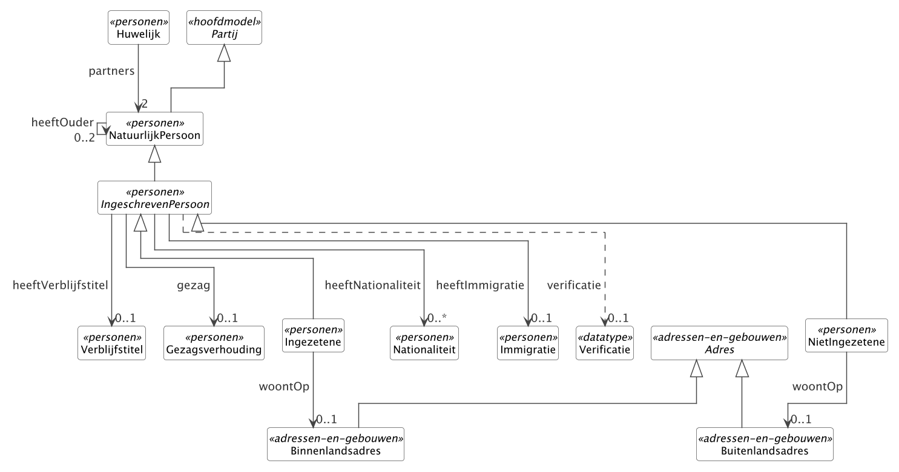

```{=openxml}
<w:p><w:r><w:br w:type="page"/></w:r></w:p>
```

# Leeswijzer

Dit document beschrijft welke gegevens de Gemeenschappelijke
Bronontsluiting (GBO) uit deze bron ontsluit en hoe die gegevens zijn
gedefinieerd. Het is een consultatieversie: wij vragen de bronhouder en
andere betrokkenen de inhoud te toetsen en van opmerkingen te voorzien.

**Wat wij vragen te toetsen**

- Kloppen de definities en de herkomstverwijzingen per objecttype en per
  gegeven?
- Kloppen kardinaliteit, datatype en de aanduiding Authentiek?
- Ontbreken er gegevens die afnemers uit deze bron nodig hebben, of staan
  er gegevens in die de bron niet kan leveren?
- Zijn de afbakeningskeuzes (hoofdstuk 3.7) en de open punten (bijlage D)
  herkenbaar en juist?

**Hoe te reageren**

Reageer met opmerkingen in dit Word-document, of vul de reactietabel in
hoofdstuk 4 in. Verwijs waar mogelijk naar het objecttype en het gegeven
(bijvoorbeeld *IngeschrevenPersoon.indicatieGeheim*) of naar een
toetsvraag (T1, T2, …). Stuur de reactie vóór de reactietermijn aan de
contactpersoon op het voorblad.

**Wat er met reacties gebeurt**

Elke reactie wordt vastgelegd in het consultatielog van GBO met een
dispositie (overgenomen, afgewezen met reden, of uitgesteld naar een
volgende versie). Overgenomen wijzigingen landen in het model, waarna
een nieuwe versie van dit document wordt gegenereerd; bijlage D toont
dan wat er is veranderd. Dit document wordt niet met de hand bewerkt.

**Opbouw**

De hoofdtekst (hoofdstuk 1 tot en met 4) bevat de kerngegevens: per
objecttype de definitie, herkomst en populatie, en per gegeven naam,
definitie, type, kardinaliteit, authentiek en herkomst. De bijlagen
bevatten alle overige MIM-metagegevens, de volledige herleiding naar de
brondocumenten en het koppelvlak, de datatypen en codelijsten, de
wijzigingen en open punten, en de verantwoording.

```{=openxml}
<w:p><w:r><w:br w:type="page"/></w:r></w:p>
```

# 1 Samenvatting

Persoonsgegevens uit de BRP (GBA en RNI), inclusief de persoonslijst-categorieën nationaliteit, huwelijk, verblijfstitel, gezagsverhouding en immigratie, en het binnenlandse verblijfadres.

GBO ontsluit uit de Basisregistratie Personen (BRP):

| Onderdeel | Aantal | Toelichting |
|-----------------------------------|------------|---------------------------------------------------------------------------------------------|
| Objecttypen | 13 | waarvan 3 abstract (supertypen zonder eigen exemplaren) |
| Attribuutsoorten | 56 | eigen attributen van de objecttypen, inclusief gestructureerde datatypen |
| Relatiesoorten | 8 | verbanden tussen objecttypen binnen deze bron |
| Sleutelverwijzingen | 1 | relaties naar objecttypen buiten deze bron, geleverd als sleutel |
| Gestructureerde datatypen | 1 | Verificatie |
| Enumeraties | 6 | Geslacht, OpschortingBijhouding, IndicatieJaNee, Indicatie, SoortVerbintenis, IndicatieGezag |
| Codelijsten | 7 | Codelijst LT38, Codelijst ISO3166, Codelijst LT33, Codelijst LT60, Codelijst LT37, Codelijst LT41, Codelijst IND |

**Bevraging.** Ingang: IngeschrevenPersoon, alleen op de natuurlijke sleutel, zonder lijstbevraging. Benoemde queries: bewijsVanOverlijdenNaaste.

**Bewust niet ontsloten.** Attributen: IngeschrevenPersoon.aNummer. Relaties: Ingezetene.heeftBriefadres, Binnenlandsadres.wordtGevormdDoor. Zie 3.7 voor de redenen.

| Objecttype | Rol | Attr. | Rel. | Herkomst |
|-----------------------------------|---------------------------------------|-----------|-----------|-------------------------------------------|
| NatuurlijkPersoon | subtype van Partij | 11 | 1 | BRP cat 01 (basis); semantische verbreding voor personen buiten de Nederlandse persoonsregistratie |
| IngeschrevenPersoon | ingang | 10 | 4 | BRP |
| Ingezetene | subtype van IngeschrevenPersoon | 1 | 1 | BRP |
| NietIngezetene | subtype van IngeschrevenPersoon | 3 | 1 | BRP |
| Nationaliteit | eigen objecttype | 5 | 0 | BRP cat 04 |
| Huwelijk | eigen objecttype | 6 | 1 | BRP cat 05 |
| Verblijfstitel | eigen objecttype | 3 | 0 | BRP cat 10 |
| Gezagsverhouding | eigen objecttype | 2 | 0 | BRP cat 11 |
| Immigratie | eigen objecttype | 2 | 0 | BRP cat 08 |
| Binnenlandsadres | subtype van Adres | 7 | 0 | BAG (afgeleid uit de Nummeraanduiding-keten) |
| Buitenlandsadres | subtype van Adres | 5 | 0 | GBO / BRP (RNI-context) |
| Adres | supertype, automatisch meegenomen | 1 | 0 | GBO (samengestelde view boven BAG, RSGB en BRP) |
| Partij | supertype, automatisch meegenomen | 0 | 1 | – |

```{=openxml}
<w:p><w:r><w:br w:type="page"/></w:r></w:p>
```

# 2 Totstandkoming

## 2.1 GBO in het kort

De Gemeenschappelijke Bronontsluiting (GBO) is een landelijke,
sectoroverstijgende specificatie voor de semantische beschrijving van
basisgegevens uit overheidsregistraties. GBO legt per bron vast welke
objecttypen en gegevens worden ontsloten, met één gedeeld
begrippenkader en informatiemodel, zodat afnemers uit verschillende
sectoren dezelfde gegevens op dezelfde manier begrijpen. GBO vervangt
de bronregistraties niet en definieert niets opnieuw: waar de bron een
definitie heeft, neemt GBO die over en verwijst ernaar.

## 2.2 Bronnenkeuze

GBO put per registratie uit bronnen in vier lagen:

| Laag | Soort bron | Wat | Levert |
|-----------|----------------------|-----------------------------------------------------------------|-------------------------------------------|
| L1 | Gezaghebbend | Het datamodel van de registratie zelf; anders het functioneel ontwerp of de catalogus. | Inhoudelijke definitie en structurele eigenschappen. |
| L2 | Koppelvlak | De koppelvlakspecificatie waarmee afnemers de bron bevragen. | Naamgeving, datatype, uitwisselingscontract. |
| L3 | Nationaal anker | Overheidsbrede begrippen, thesauri en referentiemodellen (NL-SBB, TOOI, GGM/RSGB, CBS). | Binding tussen registraties. |
| L4 | Internationaal | Generieke Europese vocabulaires (Core Vocabularies, schema.org). | Publicatie en vindbaarheid. |

Bij elk element is de bronkeuze in deze volgorde afgepeld, met drie
beslisregels:

1. **L1 is de standaard.** De definitie komt uit het gezaghebbende
   document van de registratie zolang dat beschikbaar is. L2 of L3 wordt
   gebruikt als L1 ontbreekt of niet voldoet, of als een functionele
   behoefte daarom vraagt (zoals herkenbare naamgeving voor afnemers van
   het koppelvlak).
2. **Bij gaten of conflicten wordt zelf afgeleid**, niet ruimer dan de
   bron toelaat. Zo'n eigen afleiding is in de kolom Herkomst herkenbaar
   aan de aanduiding "GBO" of "GBO-afleiding".
3. **Elk element draagt een herkomst.** Zonder bronverwijzing is een
   element niet vastgesteld. De kolom Herkomst in hoofdstuk 3 geeft de
   vindplaats in het brondocument; bijlage B geeft de volledige
   herleiding.

## 2.3 Brondocumenten voor deze bron

| Laag | Document | Versie, datum | Uitgever | Gebruik in GBO |
|---------|-------------------------------------|-------------------|-------------------|--------------------------------------------------------|
| L1 | Logisch Ontwerp BRP | 2026.Q3 2026-07-01 | RvIG | Definities en structuur van de persoonslijst (categorieën, groepen, elementen) en de structuur van de landelijke tabellen. |
| L1 | Wet basisregistratie personen | – | Rijksoverheid | Wettelijke grondslag van de objecttypen en van de aanduiding van authentieke gegevens. |
| L2 | Haal Centraal BRP Personen Bevragen (OpenAPI) | 2.7.0 | RvIG | Naamgeving van attributen, datatypen en de herleiding per element naar het koppelvlak (bijlage B). |
| L2 | Haal Centraal BRP Tabellen Bevragen | 1.0 | RvIG | Surrogaat voor de inhoud van de landelijke tabellen (LT 32 tot en met 61), waarvan RvIG geen vrij toegankelijke publicatie biedt. |

*Logisch Ontwerp BRP*: De herkomstverwijzingen in dit document citeren deze versie. Het model is opgebouwd uit versie 4.3.0 (15 mei 2023); hoofdstuk 4 van beide versies is vergeleken en de geciteerde paragrafen, categorieën, groepen en elementen zijn ongewijzigd.

Vindplaatsen staan in bijlage E.

## 2.4 Deze bron in GBO


De Basisregistratie Personen (BRP) is in GBO de bron voor de
natuurlijke persoon zoals die op een persoonslijst is geregistreerd:
ingezetenen van een Nederlandse gemeente en, via de Registratie
Niet-Ingezetenen (RNI), personen buiten Nederland met een relatie tot
de Nederlandse overheid. GBO ontsluit uit deze bron de kern van de
persoonslijst: identificatie, naam, geboorte, geslacht, overlijden,
nationaliteit, huwelijk en geregistreerd partnerschap, verblijfstitel,
gezag, immigratie, inschrijving en bijhoudingsstatus, en het actuele
verblijfadres. Gegevens over reisdocumenten, afnemersindicaties en
verwijsgegevens blijven buiten deze bron.

De bevraging loopt via het burgerservicenummer van de ingeschreven
persoon. Gerelateerden (ouders en partners) worden geleverd zoals zij
op de eigen persoonslijst voorkomen, als natuurlijk persoon zonder
doorverwijzing naar hun eigen persoonslijst. Een afnemer die gegevens
van een gerelateerde nodig heeft, doet daarvoor een eigen bevraging
met een eigen grondslag.

De modellering is afgeleid van het Logisch Ontwerp BRP en getoetst
aan de Haal Centraal BRP Personen Bevragen API, zodat de naamgeving
herkenbaar is voor afnemers die dat koppelvlak kennen. Waar het LO en
Haal Centraal verschillen, volgt de definitie het LO en de naamgeving
Haal Centraal; bijlage B toont per element beide.

## 2.5 Conformiteit met MIM 1.2

GBO is opgesteld conform het **Metamodel voor Informatiemodellen (MIM),
versie 1.2** (Geonovum, vastgesteld 13 juni 2024). De metagegevens in dit
document zijn de MIM-metagegevens voor objecttypen, attribuutsoorten en
relatiesoorten (MIM 1.2, paragraaf 2.4.3 en 3.2.1); zij dragen de
MIM-naam en staan in de MIM-volgorde. Metagegevens die GBO niet
vastlegt, staan niet in dit document. Binnen de keuzeruimte van MIM heeft
GBO de volgende keuzes gemaakt (vastgesteld 13 mei 2026):

| Keuze | Invulling in GBO |
|-------------------------|-------------------------------------------------------------------------------------------------------------------|
| Relatiemodellering | Relatiesoort leidend: relaties zijn benoemd vanuit de relatienaam (heeftOuder, woontOp) met de kardinaliteit aan de doelzijde; relatierollen worden niet apart gevoerd. |
| Historie-indicaties | Standaard Nee/Nee. Objecttypen die het patroon Voorkomen dragen (bitemporele historie) krijgen Ja/Ja op hun attribuut- en relatiesoorten. |
| Begrip | Elk objecttype, elke enumeratie en elk gedeeld begrip heeft een begrip-URI onder begrippen.gbo-semantiek.nl/id/begrip/, waaronder het begrip als SKOS wordt gepubliceerd. |
| Definitie | De definitie staat altijd als tekst in het model; de begrip-URI is een aanvullende, machineleesbare verwijzing (MIM-extensie: begrip of definitie). |
| Authentiek | Authentiek: uit L1 en daar als authentiek aangemerkt. Basisgegeven: uit L1 zonder authentiek-merk. Landelijk kerngegeven: uit L2 of L3. Overig: GBO-eigen of L4. |
| Datum opname | De basis van het model draagt één opnamedatum (28 april 2026); later toegevoegde elementen dragen hun werkelijke datum, wijzigingen een datum wijziging. |
| Indicatie abstract object | Alleen ingevuld (Ja) bij abstracte supertypen; concrete objecttypen voeren het veld niet. |
| Alias | Alleen bij een echt naamsverschil met de bronregistratie. |
| Populatie en kwaliteit | Populatie is op elk objecttype ingevuld; Kwaliteit alleen waar de bronregistratie een kwaliteitsnorm kent. |

## 2.6 Publicatie als Linked Data

GBO publiceert hetzelfde model ook als **Linked Data**, volgens MIM 1.2
hoofdstuk 4 (metamodel in Linked Data) en bijlage 6.4 (transformatie naar
RDFS/OWL en SHACL). Elk objecttype en elk gegeven heeft een URI onder
`lod.gbo-semantiek.nl` (bijvoorbeeld https://begrippen.gbo-semantiek.nl/id/begrip/NatuurlijkPersoon); de
MIM-metagegevens zijn daar RDF-eigenschappen in de namespace
`https://lod.gbo-semantiek.nl/def/mim#`, die via `owl:equivalentProperty` zijn gekoppeld aan de
MIM-ontologie (`http://bp4mc2.org/def/mim#`). De begrippen staan als SKOS onder
`begrippen.gbo-semantiek.nl`. Wie dat wil, kan de feiten in dit document
zo ook machinaal toetsen; de vindplaatsen staan in bijlage E. Afgeleide
technische vormen (het GraphQL-schema per bron, OWL, SHACL en JSON-LD)
worden daar genoemd, niet beschreven.

## 2.7 Van model naar dit document

Dit document is gegenereerd en wordt niet met de hand bewerkt. De keten:

1. Het **informatiemodel** staat in LinkML, per deelmodel één bestand, met
   per element de MIM-metagegevens als annotaties.
2. Het **bronprofiel** van deze bron benoemt welke objecttypen de bron
   levert, de ingangen voor bevraging, benoemde queries en toetsen, en
   wat bewust wordt uitgesloten.
3. Uit beide wordt de **bronuitsnede** gematerialiseerd: dezelfde uitsnede
   waaruit ook het GraphQL-schema van deze bron wordt gegenereerd.
4. De generator zet de uitsnede om in dit document en voegt de
   handgeschreven context, toetsvragen en open punten toe.

Voettekst en bijlage E vermelden de modelversie, de commit van de
modelbron en de generatiedatum, zodat elke opmerking aan een exacte
modelstand is te koppelen.

```{=openxml}
<w:p><w:r><w:br w:type="page"/></w:r></w:p>
```

# 3 Specificatie

## 3.1 Overzicht

{width=100%}

Objecttypen in deze bron, in de volgorde van het bronprofiel; supertypen die het model automatisch meeneemt staan achteraan.

- **NatuurlijkPersoon** (subtype van Partij): Een mens als drager van burgerlijke rechten en plichten.
- **IngeschrevenPersoon** (abstract, subtype van NatuurlijkPersoon): Een natuurlijke persoon die in de Basisregistratie Personen is opgenomen, hetzij als ingezetene van een Nederlandse gemeente, hetzij als niet-ingezetene in de …
- **Ingezetene** (subtype van IngeschrevenPersoon): Een ingeschreven persoon die zijn adres heeft op het grondgebied van een Nederlandse gemeente en daar door die gemeente in de basisregistratie wordt …
- **NietIngezetene** (subtype van IngeschrevenPersoon): Een ingeschreven persoon die niet als ingezetene van een Nederlandse gemeente is geregistreerd en wiens persoonslijst centraal wordt bijgehouden in de …
- **Nationaliteit**: Een nationaliteit die aan een ingeschreven persoon is toegekend, inclusief de gebeurtenis van verkrijging en eventueel verlies.
- **Huwelijk**: Een formele verbintenis tussen twee natuurlijke personen, hetzij een huwelijk in de zin van het burgerlijk recht, hetzij een geregistreerd partnerschap.
- **Verblijfstitel**: De verblijfsrechtelijke status van een ingeschreven persoon die niet de Nederlandse nationaliteit bezit.
- **Gezagsverhouding**: De juridische gezagssituatie van een ingeschreven persoon: ouderlijk gezag bij minderjarigheid of onder-curatele-stelling bij meerderjarigheid.
- **Immigratie**: De gebeurtenis waarbij een ingeschreven persoon zich vanuit het buitenland in Nederland vestigt en daarmee in de BRP wordt opgenomen of zijn inschrijving wordt …
- **Binnenlandsadres** (subtype van Adres): Een Nederlands adres dat via een BAG-Nummeraanduiding en de bijbehorende openbare ruimte en woonplaats wordt opgebouwd.
- **Buitenlandsadres** (subtype van Adres): Een adres buiten Nederland weergegeven als één tot drie vrije adresregels samen met een landaanduiding.
- **Adres** (abstract): Een leesbare aanduiding van een locatie of correspondentiepunt waarmee een persoon of organisatie kan worden bereikt of waarop een rechtsbetrekking is …
- **Partij** (abstract): Abstract supertype van natuurlijke en niet-natuurlijke personen: iedere actor die in een overheidsregistratie als rechts- of handelingssubject voorkomt.

## 3.2 Objecttypen

### NatuurlijkPersoon

*«Objecttype», subtype van Partij, subtypen: IngeschrevenPersoon, deelmodel personen*

| MIM-metagegeven | Waarde |
|------------------------------|--------------------------------------------------------------------------------------------------------------|
| Naam | NatuurlijkPersoon |
| Definitie | Een mens als drager van burgerlijke rechten en plichten. |
| Alias | Persoon, Mens |
| Herkomst | BRP cat 01 (basis); semantische verbreding voor personen buiten de Nederlandse persoonsregistratie |
| Herkomst definitie | Bron: Logisch Ontwerp BRP 2026.Q3 (RvIG, 1 juli 2026), §1 (operationele invulling binnen de basisregistratie). |
| Populatie | Alle natuurlijke personen die voor een overheidsorganisatie relevant zijn: ingeschrevenen in BRP-GBA en BRP-RNI, en niet-ingeschrevenen (buitenlandse partner van een ingezetene, historisch persoon zonder persoonslijst, buitenlandse eigenaar van een eenmanszaak). |
| Kwaliteit | Voor BRP-ingeschrevenen geldt de BRP-bijhouding-status (opschortingBijhouding, inOnderzoek) als kwaliteitsindicator. Voor niet-ingeschrevenen ontbreekt zo'n centrale kwaliteitsstempel; bronvermelding per attribuut is dan leidend. |
| Unieke aanduiding | bsn (op IngeschrevenPersoon) |

*Toelichting.* NatuurlijkPersoon omvat zowel mensen die in een Nederlandse persoonsregistratie zijn opgenomen als mensen daarbuiten. Registratielagen (IngeschrevenPersoon, Ingezetene, NietIngezetene) zijn specifieke varianten binnen het natuurlijk-persoon-concept. Overlijden hangt als attribuut-cluster aan NatuurlijkPersoon zelf.

*Toelichting.* De symmetrische partner-relatie loopt via Huwelijk.partners (kardinaliteit 2); zie het objecttype Huwelijk.

Erft daarnaast van Partij: ingeschrevenAls.

**Attribuutsoorten**

| Naam | Definitie | Type | Kard. | Authentiek | Herkomst |
|-----------------------|------------------------------------------|-------------------|-----------|-----------------------|----------------------|
| geslachtsnaam | De officiële familienaam van de persoon. | Tekst | 1 | Basisgegeven | BRP cat 01 grp 02 |
| voornamen | Alle officiële voornamen van de persoon. | Tekst | 0..1 | Basisgegeven | BRP cat 01 grp 02 |
| voorvoegsel | Het voorvoegsel bij de geslachtsnaam. | Tekst | 0..1 | Basisgegeven | BRP cat 01 grp 02 |
| adellijkeTitelPredicaat | Adellijke titel of predicaat. | Codelijst LT38 | 0..1 | Basisgegeven | BRP cat 01 grp 02 |
| geboortedatum | De datum waarop de persoon is geboren. | DatumIncompleet | 0..1 | Basisgegeven | BRP cat 01 grp 03 |
| geboorteplaats | De gemeente of plaats waar de persoon is geboren. | Tekst | 0..1 | Basisgegeven | BRP cat 01 grp 03 |
| geboorteland | Het land waar de persoon is geboren. | Codelijst ISO3166 | 0..1 | Basisgegeven | BRP cat 01 grp 03 |
| geslacht | Het geslacht van de persoon. | Geslacht (enumeratie) | 0..1 | Basisgegeven | BRP cat 01 grp 04 |
| datumOverlijden | De datum waarop de persoon is overleden. | DatumIncompleet | 0..1 | Basisgegeven | BRP cat 06 grp 08 |
| plaatsOverlijden | De plaats waar de persoon is overleden. | Tekst | 0..1 | Basisgegeven | BRP cat 06 grp 08 |
| landOverlijden | Het land waar de persoon is overleden. | Codelijst ISO3166 | 0..1 | Basisgegeven | BRP cat 06 grp 08 |

**Relatiesoorten**

| Naam | Doel | Kard. | Authentiek | Herkomst | Definitie |
|----------------------|----------------------|----------|---------------------|---------------------|-------------------------------------------|
| heeftOuder | NatuurlijkPersoon | 0..2 | Basisgegeven | BRP cat 02/03 | De ouder(s) van deze persoon. |
| heeftHuwelijk (afgeleide inverse van Huwelijk.partners) | Huwelijk | 0..\* | – | GBO-afleiding | De huwelijken of geregistreerde partnerschappen van deze persoon. |

### IngeschrevenPersoon

*«Objecttype», abstract, subtype van NatuurlijkPersoon, subtypen: Ingezetene, NietIngezetene, deelmodel personen*

| MIM-metagegeven | Waarde |
|------------------------------|--------------------------------------------------------------------------------------------------------------|
| Naam | IngeschrevenPersoon |
| Definitie | Een natuurlijke persoon die in de Basisregistratie Personen is opgenomen, hetzij als ingezetene van een Nederlandse gemeente, hetzij als niet-ingezetene in de Registratie Niet-Ingezetenen. |
| Herkomst | BRP |
| Herkomst definitie | Bron: Logisch Ontwerp BRP 2026.Q3 (RvIG, 1 juli 2026), §1 (registratiedomein BRP). |
| Populatie | Alle natuurlijke personen met een actieve of opgeschorte BRP-inschrijving (BRP-GBA of BRP-RNI). |
| Kwaliteit | Geborgd via BRP-bijhouding-status: opschortingBijhouding, inOnderzoek, verificatie. |
| Unieke aanduiding | bsn |
| Indicatie abstract object | Ja |
| Patronen | Voorkomen |
| Begrip | <https://begrippen.gbo-semantiek.nl/id/begrip/IngeschrevenPersoon> |

*Toelichting.* IngeschrevenPersoon is de drager van de BRP-persoonslijst-gegevens (identificatienummers, bijhouding-status, kiesrechtgegevens) en het aanknopingspunt voor de BRP-persoonslijst-categorieën (nationaliteit, huwelijk, verblijfstitel, gezagsverhouding, immigratie). Het objecttype draagt het Voorkomen-mixin zodat alle BRP-gegevens bitemporeel kunnen worden gevoerd. De twee concrete varianten Ingezetene en NietIngezetene staan onder dit objecttype.

Erft daarnaast van NatuurlijkPersoon: geslachtsnaam, voornamen, voorvoegsel, adellijkeTitelPredicaat, geboortedatum, geboorteplaats, geboorteland, geslacht, datumOverlijden, plaatsOverlijden, landOverlijden, heeftOuder, heeftHuwelijk; Partij: ingeschrevenAls; Voorkomen: beginGeldigheid, eindGeldigheid, tijdstipRegistratie, eindRegistratie, versie.

**Attribuutsoorten**

| Naam | Definitie | Type | Kard. | Authentiek | Herkomst |
|-----------------------|------------------------------------------|-------------------|-----------|-----------------------|----------------------|
| bsn | Het door de Beheervoorziening BSN uitgegeven persoonsnummer. | BSN | 1 | Authentiek | BRP cat 01 grp 01 |
| tin | Het persoonsnummer dat een ander land aan deze persoon heeft toegekend. | Alfanumeriek | 0..1 | Basisgegeven | BRP cat 04 grp 73 |
| datumEersteInschrijving | De datum waarop deze persoon voor het eerst in de BRP werd opgenomen. | DatumIncompleet | 0..1 | Basisgegeven | BRP cat 07 grp 68 |
| gemeenteVanInschrijving | De gemeente die de persoonslijst bijhoudt. | Codelijst LT33 | 0..1 | Basisgegeven | BRP cat 08 grp 09 |
| opschortingBijhouding | Reden waarom bijhouding van de persoonslijst is opgeschort. | OpschortingBijhouding (enumeratie) | 0..1 | Basisgegeven | BRP cat 07 grp 67 |
| uitsluitingKiesrecht | Aanduiding dat de persoon door rechterlijke uitspraak van het kiesrecht voor de Tweede Kamer en provinciale staten is uitgesloten. | IndicatieJaNee (enumeratie) | 0..1 | Basisgegeven | BRP cat 13 |
| europeesKiesrecht | Aanduiding dat de persoon kiesgerechtigd is voor het Europees Parlement vanuit Nederland. | IndicatieJaNee (enumeratie) | 0..1 | Basisgegeven | BRP cat 13 |
| indicatieGeheim | Aanduiding dat verstrekking van gegevens over deze persoon aan derden is beperkt. | Indicatie (enumeratie) | 1 | Basisgegeven | BRP cat 07 grp 70 |
| verificatie | Datum en wijze van de laatste verificatie van de gegevens op de persoonslijst in de RNI. | Verificatie (gestructureerd) | 0..1 | Basisgegeven | BRP cat 07 grp 71 |
| inOnderzoek | Indicatie dat een of meer gegevens van de persoonslijst onderwerp zijn van onderzoek. | Indicatie (enumeratie) | 1 | Basisgegeven | BRP cat 07 |

**Relatiesoorten**

| Naam | Doel | Kard. | Authentiek | Herkomst | Definitie |
|----------------------|----------------------|----------|---------------------|---------------------|-------------------------------------------|
| heeftNationaliteit | Nationaliteit | 0..\* | Authentiek | BRP cat 04 | Nationaliteiten conform BRP cat 04. |
| heeftVerblijfstitel | Verblijfstitel | 0..1 | Basisgegeven | BRP cat 10 | Aanwezig bij niet-Nederlandse onderdanen. |
| gezag | Gezagsverhouding | 0..1 | Basisgegeven | BRP cat 11 | Aanwezig bij minderjarigheid of curatele. |
| heeftImmigratie | Immigratie | 0..1 | Basisgegeven | BRP cat 08 grp 14 | Aanwezig bij vestiging vanuit het buitenland. |

### Ingezetene

*«Objecttype», subtype van IngeschrevenPersoon, deelmodel personen*

| MIM-metagegeven | Waarde |
|------------------------------|--------------------------------------------------------------------------------------------------------------|
| Naam | Ingezetene |
| Definitie | Een ingeschreven persoon die zijn adres heeft op het grondgebied van een Nederlandse gemeente en daar door die gemeente in de basisregistratie wordt bijgehouden. |
| Herkomst | BRP |
| Herkomst definitie | Bron: Logisch Ontwerp BRP 2026.Q3 (RvIG, 1 juli 2026), §1.5 (BRP-GBA-spoor). |
| Populatie | Alle in een Nederlandse gemeente ingeschreven natuurlijke personen, met of zonder Nederlandse nationaliteit. |
| Kwaliteit | Geborgd via BRP-bijhouding (gemeente verantwoordelijk). |
| Unieke aanduiding | bsn (geërfd) |
| Begrip | <https://begrippen.gbo-semantiek.nl/id/begrip/Ingezetene> |

*Toelichting.* Ingezetene is het BRP-GBA-spoor, de gemeentelijk bijgehouden tak van de basisregistratie. Een Ingezetene woont op een Binnenlandsadres of, in uitzonderingsgevallen, op een Postadres (briefadres) of een verblijfplaats-aanduiding zonder vast adres.

Erft daarnaast van IngeschrevenPersoon: bsn, tin, datumEersteInschrijving, gemeenteVanInschrijving, opschortingBijhouding, uitsluitingKiesrecht, europeesKiesrecht, indicatieGeheim, verificatie, inOnderzoek, heeftNationaliteit, heeftVerblijfstitel, gezag, heeftImmigratie; NatuurlijkPersoon: geslachtsnaam, voornamen, voorvoegsel, adellijkeTitelPredicaat, geboortedatum, geboorteplaats, geboorteland, geslacht, datumOverlijden, plaatsOverlijden, landOverlijden, heeftOuder, heeftHuwelijk; Partij: ingeschrevenAls.

**Attribuutsoorten**

| Naam | Definitie | Type | Kard. | Authentiek | Herkomst |
|-----------------------|------------------------------------------|-------------------|-----------|-----------------------|----------------------|
| datumInschrijvingGemeente | De datum waarop de persoon zich in de huidige gemeente heeft ingeschreven. | Datum | 0..1 | Basisgegeven | BRP cat 08 grp 09 |

**Relatiesoorten**

| Naam | Doel | Kard. | Authentiek | Herkomst | Definitie |
|----------------------|----------------------|----------|---------------------|---------------------|-------------------------------------------|
| woontOp | Binnenlandsadres | 0..1 | Authentiek | BRP cat 08 grp 10/11 | Verblijfadres; zie deelmodel Adressen en gebouwen. |

### NietIngezetene

*«Objecttype», subtype van IngeschrevenPersoon, deelmodel personen*

| MIM-metagegeven | Waarde |
|------------------------------|--------------------------------------------------------------------------------------------------------------|
| Naam | NietIngezetene |
| Definitie | Een ingeschreven persoon die niet als ingezetene van een Nederlandse gemeente is geregistreerd en wiens persoonslijst centraal wordt bijgehouden in de Registratie Niet-Ingezetenen. |
| Herkomst | BRP |
| Herkomst definitie | Bron: Logisch Ontwerp BRP 2026.Q3 (RvIG, 1 juli 2026), §1.5 (BRP-RNI-spoor). |
| Populatie | Alle in de RNI ingeschreven natuurlijke personen: voormalig ingezetenen die zijn geëmigreerd én nooit-ingezetenen met een Nederlandse relatie (grensarbeider, buitenlandse student, ambtenaar in het buitenland). |
| Kwaliteit | Geborgd via RNI-bijhouding door aangewezen RNI-deelnemers (Belastingdienst, IND, UWV, SVB en grensgemeenten). |
| Unieke aanduiding | bsn (geërfd) |
| Begrip | <https://begrippen.gbo-semantiek.nl/id/begrip/NietIngezetene> |

*Toelichting.* NietIngezetene is het BRP-RNI-spoor: centraal bijgehouden onder verantwoordelijkheid van de Minister van BZK voor personen met een relatie tot Nederland zonder gemeentelijke inschrijving. De persoonslijst is gereduceerd: geen ouders, kinderen, huwelijk, gezag, reisdocument of kiesrecht.

Erft daarnaast van IngeschrevenPersoon: bsn, tin, datumEersteInschrijving, gemeenteVanInschrijving, opschortingBijhouding, uitsluitingKiesrecht, europeesKiesrecht, indicatieGeheim, verificatie, inOnderzoek, heeftNationaliteit, heeftVerblijfstitel, gezag, heeftImmigratie; NatuurlijkPersoon: geslachtsnaam, voornamen, voorvoegsel, adellijkeTitelPredicaat, geboortedatum, geboorteplaats, geboorteland, geslacht, datumOverlijden, plaatsOverlijden, landOverlijden, heeftOuder, heeftHuwelijk; Partij: ingeschrevenAls.

**Attribuutsoorten**

| Naam | Definitie | Type | Kard. | Authentiek | Herkomst |
|-----------------------|------------------------------------------|-------------------|-----------|-----------------------|----------------------|
| datumInschrijvingRNI | De datum waarop de persoon in de RNI is ingeschreven. | Datum | 0..1 | Basisgegeven | BRP cat 08 grp 09 |
| landVanVerblijf | Het land waarin de niet-ingezetene zijn verblijfplaats heeft. | Codelijst ISO3166 | 0..1 | Basisgegeven | BRP cat 08 grp 13 |
| deelnemerCodeRNI | De RNI-deelnemer die (een deel van) de gegevens op de persoonslijst heeft aangeleverd. | Codelijst LT60 | 0..1 | Basisgegeven | BRP cat 07 grp 88 |

**Relatiesoorten**

| Naam | Doel | Kard. | Authentiek | Herkomst | Definitie |
|----------------------|----------------------|----------|---------------------|---------------------|-------------------------------------------|
| woontOp | Buitenlandsadres | 0..1 | Basisgegeven | BRP cat 08 grp 13 | Verblijfadres in het buitenland; zie deelmodel Adressen en gebouwen. |

### Nationaliteit

*«Objecttype», deelmodel personen*

| MIM-metagegeven | Waarde |
|------------------------------|--------------------------------------------------------------------------------------------------------------|
| Naam | Nationaliteit |
| Definitie | Een nationaliteit die aan een ingeschreven persoon is toegekend, inclusief de gebeurtenis van verkrijging en eventueel verlies. |
| Herkomst | BRP cat 04 |
| Herkomst definitie | Bron: Logisch Ontwerp BRP 2026.Q3 (RvIG, 1 juli 2026), cat 04 Nationaliteit. |
| Populatie | Alle aan een ingeschreven persoon toegekende nationaliteiten, inclusief inmiddels verloren nationaliteiten voor zover die historisch worden bijgehouden. |
| Unieke aanduiding | geen |
| Begrip | <https://begrippen.gbo-semantiek.nl/id/begrip/Nationaliteit> |

*Toelichting.* Een ingeschreven persoon kan meerdere nationaliteiten hebben. Elke nationaliteit is een zelfstandig objecttype zodat verkrijging en verlies per nationaliteit historisch traceerbaar zijn.

**Attribuutsoorten**

| Naam | Definitie | Type | Kard. | Authentiek | Herkomst |
|-----------------------|------------------------------------------|-------------------|-----------|-----------------------|----------------------|
| nationaliteit | De nationaliteit zelf, als landcode. | Codelijst ISO3166 | 1 | Authentiek | BRP cat 04 grp 05 |
| redenVerkrijging | De reden waarom de nationaliteit is verkregen. | Codelijst LT37 | 0..1 | Basisgegeven | BRP cat 04 grp 63 |
| redenVerlies | De reden waarom de nationaliteit is verloren. | Codelijst LT37 | 0..1 | Basisgegeven | BRP cat 04 grp 64 |
| datumVerkrijging | De datum waarop de nationaliteit is verkregen. | DatumIncompleet | 0..1 | Basisgegeven | BRP cat 04 grp 63 |
| datumVerlies | De datum waarop de nationaliteit is verloren. | DatumIncompleet | 0..1 | Basisgegeven | BRP cat 04 grp 64 |

### Huwelijk

*«Objecttype», deelmodel personen*

| MIM-metagegeven | Waarde |
|------------------------------|--------------------------------------------------------------------------------------------------------------|
| Naam | Huwelijk |
| Definitie | Een formele verbintenis tussen twee natuurlijke personen, hetzij een huwelijk in de zin van het burgerlijk recht, hetzij een geregistreerd partnerschap. |
| Herkomst | BRP cat 05 |
| Herkomst definitie | Bron: Logisch Ontwerp BRP 2026.Q3 (RvIG, 1 juli 2026), cat 05 Huwelijk/Geregistreerd Partnerschap. |
| Populatie | Alle geregistreerde huwelijken en geregistreerde partnerschappen waarvan ten minste één partner in de BRP is opgenomen, plus huwelijken tussen niet-ingeschreven natuurlijke personen voor zover relevant. |
| Unieke aanduiding | geen |
| Begrip | <https://begrippen.gbo-semantiek.nl/id/begrip/Huwelijk> |

*Toelichting.* Huwelijk koppelt twee NatuurlijkPersonen symmetrisch via één partners-relatie (2..2), ongeacht hun BRP-inschrijfstatus. Het onderscheid tussen huwelijk en geregistreerd partnerschap loopt via soortVerbintenis. Ontbinding, inclusief overlijden van een partner of echtscheiding, zit als attribuut op het huwelijk zelf.

**Attribuutsoorten**

| Naam | Definitie | Type | Kard. | Authentiek | Herkomst |
|-----------------------|------------------------------------------|-------------------|-----------|-----------------------|----------------------|
| soortVerbintenis | Onderscheidt huwelijk van geregistreerd partnerschap. | SoortVerbintenis (enumeratie) | 1 | Basisgegeven | BRP cat 05 |
| datumVoltrekking | De datum waarop de verbintenis is aangegaan. | DatumIncompleet | 0..1 | Basisgegeven | BRP cat 05 grp 06 |
| plaatsVoltrekking | De plaats waar de verbintenis is aangegaan. | Tekst | 0..1 | Basisgegeven | BRP cat 05 grp 06 |
| landVoltrekking | Het land waarin de verbintenis is aangegaan. | Codelijst ISO3166 | 0..1 | Basisgegeven | BRP cat 05 grp 06 |
| datumOntbinding | De datum waarop de verbintenis is ontbonden. | DatumIncompleet | 0..1 | Basisgegeven | BRP cat 05 grp 07 |
| redenOntbinding | De reden van ontbinding (echtscheiding, overlijden, nietigverklaring). | Codelijst LT41 | 0..1 | Basisgegeven | BRP cat 05 grp 07 |

**Relatiesoorten**

| Naam | Doel | Kard. | Authentiek | Herkomst | Definitie |
|----------------------|----------------------|----------|---------------------|---------------------|-------------------------------------------|
| partners | NatuurlijkPersoon | 2 | Basisgegeven | BRP cat 05 | Symmetrisch; geen aangaande/partner-onderscheid. |

### Verblijfstitel

*«Objecttype», deelmodel personen*

| MIM-metagegeven | Waarde |
|------------------------------|--------------------------------------------------------------------------------------------------------------|
| Naam | Verblijfstitel |
| Definitie | De verblijfsrechtelijke status van een ingeschreven persoon die niet de Nederlandse nationaliteit bezit. |
| Herkomst | BRP cat 10 |
| Herkomst definitie | Bron: Logisch Ontwerp BRP 2026.Q3 (RvIG, 1 juli 2026), cat 10 Verblijfstitel. |
| Populatie | Alle aan ingeschreven personen toegekende verblijfstitels conform de Vreemdelingenwet 2000, voor zover door de IND aan de BRP gemeld. |
| Unieke aanduiding | geen |
| Begrip | <https://begrippen.gbo-semantiek.nl/id/begrip/Verblijfstitel> |

*Toelichting.* Verblijfstitel hangt 0..1 aan IngeschrevenPersoon en is aanwezig bij personen zonder Nederlandse nationaliteit voor wie de IND een verblijfsrecht heeft vastgesteld. De aanduiding volgt de IND-codelijst; de cross-walk naar LT 56 ondersteunt BRP-equivalentie.

**Attribuutsoorten**

| Naam | Definitie | Type | Kard. | Authentiek | Herkomst |
|-----------------------|------------------------------------------|-------------------|-----------|-----------------------|----------------------|
| aanduiding | De aanduiding van het verblijfsrecht (IND-codelijst). | Codelijst IND | 1 | Basisgegeven | BRP cat 10 grp 39 |
| datumIngang | De datum waarop het verblijfsrecht is ingegaan. | DatumIncompleet | 0..1 | Basisgegeven | BRP cat 10 grp 39 |
| datumEinde | De datum waarop het verblijfsrecht is geëindigd. | DatumIncompleet | 0..1 | Basisgegeven | BRP cat 10 grp 39 |

### Gezagsverhouding

*«Objecttype», deelmodel personen*

| MIM-metagegeven | Waarde |
|------------------------------|--------------------------------------------------------------------------------------------------------------|
| Naam | Gezagsverhouding |
| Definitie | De juridische gezagssituatie van een ingeschreven persoon: ouderlijk gezag bij minderjarigheid of onder-curatele-stelling bij meerderjarigheid. |
| Herkomst | BRP cat 11 |
| Herkomst definitie | Bron: Logisch Ontwerp BRP 2026.Q3 (RvIG, 1 juli 2026), cat 11 Gezagsverhouding. |
| Populatie | Alle gezagssituaties van ingeschreven personen waarvoor een gezags- of curatele-aanduiding is geregistreerd. |
| Unieke aanduiding | geen |
| Begrip | <https://begrippen.gbo-semantiek.nl/id/begrip/Gezagsverhouding> |

*Toelichting.* Gezagsverhouding hangt aan IngeschrevenPersoon en is aanwezig bij minderjarigen (indicatieGezagMinderjarige) of bij meerderjarigen onder curatele (indicatieCuratele). Een verfijnde subtype-modellering met onderscheid naar gezamenlijk ouderlijk gezag, voogdij en curatele is een open onderwerp.

**Attribuutsoorten**

| Naam | Definitie | Type | Kard. | Authentiek | Herkomst |
|-----------------------|------------------------------------------|-------------------|-----------|-----------------------|----------------------|
| indicatieGezagMinderjarige | Aanduiding van het ouderlijk gezag over een minderjarige. | IndicatieGezag (enumeratie) | 0..1 | Basisgegeven | BRP cat 11 |
| indicatieCuratele | Aanduiding dat de meerderjarige persoon onder curatele is gesteld. | Indicatie (enumeratie) | 1 | Basisgegeven | BRP cat 11 |

### Immigratie

*«Objecttype», deelmodel personen*

| MIM-metagegeven | Waarde |
|------------------------------|--------------------------------------------------------------------------------------------------------------|
| Naam | Immigratie |
| Definitie | De gebeurtenis waarbij een ingeschreven persoon zich vanuit het buitenland in Nederland vestigt en daarmee in de BRP wordt opgenomen of zijn inschrijving wordt geheractiveerd. |
| Herkomst | BRP cat 08 |
| Herkomst definitie | Bron: Logisch Ontwerp BRP 2026.Q3 (RvIG, 1 juli 2026), cat 08 grp 14 Immigratie. |
| Populatie | Alle ingeschreven personen die zich vanuit het buitenland in Nederland hebben gevestigd, voor zover die vestigingsgebeurtenis als immigratie is geregistreerd. |
| Unieke aanduiding | geen |
| Begrip | <https://begrippen.gbo-semantiek.nl/id/begrip/Immigratie> |

*Toelichting.* Immigratie hangt eenmalig (0..1) aan IngeschrevenPersoon en legt vast wanneer en waarvandaan de persoon zich in Nederland heeft gevestigd. Latere wijzigingen van adres binnen Nederland zijn geen immigratie.

**Attribuutsoorten**

| Naam | Definitie | Type | Kard. | Authentiek | Herkomst |
|-----------------------|------------------------------------------|-------------------|-----------|-----------------------|----------------------|
| datumVestigingInNederland | De datum waarop de persoon zich in Nederland heeft gevestigd. | Datum | 0..1 | Basisgegeven | BRP cat 08 grp 14 |
| landVanwaar | Het land waarvandaan de persoon zich in Nederland heeft gevestigd. | Codelijst ISO3166 | 0..1 | Basisgegeven | BRP cat 08 grp 14 |

### Binnenlandsadres

*«Objecttype», subtype van Adres, deelmodel adressen-en-gebouwen*

| MIM-metagegeven | Waarde |
|------------------------------|--------------------------------------------------------------------------------------------------------------|
| Naam | Binnenlandsadres |
| Definitie | Een Nederlands adres dat via een BAG-Nummeraanduiding en de bijbehorende openbare ruimte en woonplaats wordt opgebouwd. |
| Herkomst | BAG (afgeleid uit de Nummeraanduiding-keten) |
| Herkomst definitie | Bron: Catalogus BAG 2018 (IMBAG). |
| Populatie | Alle Nederlandse adressen waarvoor een Nummeraanduiding is uitgegeven en die als woon-, bezoek- of correspondentieadres voor een afnemer relevant zijn. |
| Unieke aanduiding | adresId (BAGID, gelijk aan de Nummeraanduiding) |
| Begrip | <https://begrippen.gbo-semantiek.nl/id/begrip/Binnenlandsadres> |

*Toelichting.* BAG-gekoppeld adres met een eigen instantie per Nummeraanduiding (geen afgeleide view), geconstrueerd uit de Nummeraanduiding en de bovenliggende keten op moment van vorming.

Erft daarnaast van Adres: volledigAdres.

**Attribuutsoorten**

| Naam | Definitie | Type | Kard. | Authentiek | Herkomst |
|-----------------------|------------------------------------------|-------------------|-----------|-----------------------|----------------------|
| adresId | De identificatie van dit adres: de BAG-identificatie van de Nummeraanduiding die het adres vormt. | BAGID | 1 | Authentiek | BAG (Nummeraanduiding) |
| straatnaam | Volledige naam van de openbare ruimte. | Tekst | 1 | Basisgegeven | BAG (afgeleid OpenbareRuimte) |
| huisnummer | Het huisnummer-deel van de Nummeraanduiding. | Numeriek | 1 | Basisgegeven | BAG (Nummeraanduiding) |
| huisletter | De huisletter bij het huisnummer. | Tekst | 0..1 | Basisgegeven | BAG (Nummeraanduiding) |
| huisnummertoevoeging | De huisnummertoevoeging (bv. 2hg, bis). | Tekst | 0..1 | Basisgegeven | BAG (Nummeraanduiding) |
| postcode | De postcode behorend bij het huisnummer. | Postcode | 0..1 | Basisgegeven | BAG (Nummeraanduiding) |
| woonplaatsnaam | Naam van de bovenliggende woonplaats. | Tekst | 1 | Basisgegeven | BAG (afgeleid Woonplaats) |

### Buitenlandsadres

*«Objecttype», subtype van Adres, deelmodel adressen-en-gebouwen*

| MIM-metagegeven | Waarde |
|------------------------------|--------------------------------------------------------------------------------------------------------------|
| Naam | Buitenlandsadres |
| Definitie | Een adres buiten Nederland weergegeven als één tot drie vrije adresregels samen met een landaanduiding. |
| Herkomst | GBO / BRP (RNI-context) |
| Herkomst definitie | BRP Logisch Ontwerp §5.8 (buitenlandse adresregels van een niet-ingezetene); RSGB-Kern Buitenlandsadres. |
| Populatie | Alle adressen in het buitenland die voor een Nederlandse afnemer als verblijf-, post- of zeteladres relevant zijn. |
| Unieke aanduiding | adresId (UUID, GBO-eigen) |
| Begrip | <https://begrippen.gbo-semantiek.nl/id/begrip/Buitenlandsadres> |

*Toelichting.* Adres voor personen of vestigingen zonder Nederlands adres. Geen BAG-koppeling; geen authentieke bron in Nederland. Land verwijst naar de internationale lijst ISO 3166.

Erft daarnaast van Adres: volledigAdres.

**Attribuutsoorten**

| Naam | Definitie | Type | Kard. | Authentiek | Herkomst |
|-----------------------|------------------------------------------|-------------------|-----------|-----------------------|----------------------|
| adresId | GBO-eigen sleutel voor één adres-instantie. | UUID | 1 | Overig | GBO |
| adresregel1 | Eerste regel van het buitenlandse adres. | Tekst | 1 | Overig | GBO / BRP |
| adresregel2 | Tweede regel van het buitenlandse adres. | Tekst | 0..1 | Overig | GBO / BRP |
| adresregel3 | Derde regel van het buitenlandse adres. | Tekst | 0..1 | Overig | GBO / BRP |
| land | Landaanduiding volgens ISO 3166. | Codelijst ISO3166 | 1 | Basisgegeven | ISO 3166 / LT34 |

### Adres

*«Objecttype», abstract, subtypen: Binnenlandsadres, Buitenlandsadres, deelmodel adressen-en-gebouwen*

| MIM-metagegeven | Waarde |
|------------------------------|--------------------------------------------------------------------------------------------------------------|
| Naam | Adres |
| Definitie | Een leesbare aanduiding van een locatie of correspondentiepunt waarmee een persoon of organisatie kan worden bereikt of waarop een rechtsbetrekking is gevestigd, samengesteld uit elementen van de bronregisters BAG, RSGB en BRP. |
| Herkomst | GBO (samengestelde view boven BAG, RSGB en BRP) |
| Herkomst definitie | Wet basisregistraties adressen en gebouwen (binnenlandsadres via de BAG-keten Nummeraanduiding, OpenbareRuimte, Woonplaats); BRP Logisch Ontwerp §5.8 (woon- en briefadres-context); RSGB-Kern (overkoepelend type Adres). |
| Populatie | Alle adressen die voor een overheidsorganisatie als adresseerbaarheid of correspondentiepunt relevant zijn. |
| Unieke aanduiding | adresId (op de concrete subtypen) |
| Indicatie abstract object | Ja |
| Begrip | <https://begrippen.gbo-semantiek.nl/id/begrip/Adres> |

*Toelichting.* Adres is een samengestelde, leesbare projectie boven BAG-data, niet een zelfstandig authentiek gegeven. BAG levert de authentieke onderliggende data; de adres-projectie is voor afnemers in één keer leesbaar. De functionele rol (woon, bezoek, post, zetel) staat in de verwijzing vanuit de gebruiker (NatuurlijkPersoon, Vestiging), niet als kenmerk van Adres zelf.

**Attribuutsoorten**

| Naam | Definitie | Type | Kard. | Authentiek | Herkomst |
|-----------------------|------------------------------------------|-------------------|-----------|-----------------------|----------------------|
| volledigAdres | Gedenormaliseerde, leesbare projectie van het adres. | Tekst | 0..1 | Overig | GBO (afgeleid) |

### Partij

*«Objecttype», abstract, subtypen: NatuurlijkPersoon, deelmodel hoofdmodel*

| MIM-metagegeven | Waarde |
|------------------------------|--------------------------------------------------------------------------------------------------------------|
| Naam | Partij |
| Definitie | Abstract supertype van natuurlijke en niet-natuurlijke personen: iedere actor die in een overheidsregistratie als rechts- of handelingssubject voorkomt. |
| Herkomst | – |
| Herkomst definitie | – |
| Unieke aanduiding | bsn \| rsin \| kvkNummer (op de subtypen) |
| Indicatie abstract object | Ja |
| Begrip | <https://begrippen.gbo-semantiek.nl/id/begrip/Partij> |

*Toelichting.* Partij draagt geen eigen identifier. Een partij is uitsluitend aanwijsbaar met de authentieke sleutels van haar subtypen: bsn (IngeschrevenPersoon), rsin en kvkNummer (NietNatuurlijkPersoon). Besluit 2026-08-10; het eerdere GBO-eigen UUID-attribuut (id) is verwijderd omdat het nergens uit te vragen viel en als dood veld in de bronschema's van BRK, BRV en WOZ terechtkwam.

*Toelichting.* Gevolg voor bron-profielen: een relatie naar Partij mag niet tot een sleutel-referentie worden herleid. Wijst een relatie naar Partij, dan hoort Partij met de relevante subtypen in het profiel te staan, met een zoeksleutels-opgave op de ingang. De snoei-tool bewaakt dat.

**Relatiesoorten**

| Naam | Doel | Kard. | Authentiek | Herkomst | Definitie |
|----------------------|----------------------|----------|---------------------|---------------------|-------------------------------------------|
| ingeschrevenAls | MaatschappelijkeActiviteit (buiten deze bron; geleverd als sleutel van type KVKnummer) | 0..\* | – | NHR | De maatschappelijke activiteit(en), de op KVK-nummer geïdentificeerde inschrijvingseenheid van het Handelsregister, waarbij deze partij als eigenaar of vennoot betrokken is. |

## 3.3 Gestructureerde datatypen en patronen

### Verificatie

*«Gestructureerd datatype», deelmodel personen*

| MIM-metagegeven | Waarde |
|------------------------------|--------------------------------------------------------------------------------------------------------------|
| Naam | Verificatie |
| Definitie | Datum en wijze waarop de gegevens op een persoonslijst in de Registratie Niet-Ingezetenen zijn geverifieerd. |
| Herkomst | BRP cat 07 grp 71 Verificatie |
| Herkomst definitie | Bron: Logisch Ontwerp BRP 2026.Q3 (RvIG, 1 juli 2026), §4.6 elementen 71.10 Datum verificatie en 71.20 Omschrijving verificatie. |
| Begrip | <https://begrippen.gbo-semantiek.nl/id/begrip/Verificatie> |

*Toelichting.* Tot 2026-10-30 een enumeratie (Geverifieerd, NietGeverifieerd, InOnderzoek) zonder LO-bron. Het LO kent geen verificatiestatus, alleen een datum en een vrije omschrijving; Haal Centraal BRP Personen levert dezelfde twee velden als verificatie.datum en verificatie.omschrijving. Onderzoek naar gegevens loopt via inOnderzoek, niet via dit datatype.

**Attribuutsoorten**

| Naam | Definitie | Type | Kard. | Authentiek | Herkomst |
|-----------------------|------------------------------------------|-------------------|-----------|-----------------------|----------------------|
| datum | De datum waarop de verificatie van de gegevens op de persoonslijst in de RNI heeft plaatsgevonden. | DatumIncompleet | 0..1 | – | BRP cat 07 grp 71 |
| omschrijving | De omschrijving van de wijze waarop de verificatie van de gegevens op de persoonslijst in de RNI heeft plaatsgevonden. | Tekst | 0..1 | – | BRP cat 07 grp 71 |

### Patroon Voorkomen

Mixin van attributen die elk basisregistratie-objecttype kan dragen voor bitemporele expressiviteit conform HC-BAG en BRP-Historie: twee tijdlijnen, materiële geldigheid en formele registratie.

*Toelichting.* Voorkomen is geen klasse maar een mixin van attributen; zie hoofdmodel.md, sectie Patronen.

Gedragen door: IngeschrevenPersoon.

| Naam | Definitie | Type | Kard. |
|----------------------------------|--------------------------------------------------------------------|-------------------------|-------------|
| beginGeldigheid | Materiële tijdlijn: start van de geldigheid. | Datum | 1 |
| eindGeldigheid | Materiële tijdlijn: einde van de geldigheid; open betekent lopend. | Datum | 0..1 |
| tijdstipRegistratie | Formele tijdlijn: start van de registratie. | DatumTijd | 1 |
| eindRegistratie | Formele tijdlijn: einde van de registratie; open betekent actueel. | DatumTijd | 0..1 |
| versie | Monotone versieteller. | Numeriek | 1 |

## 3.4 Enumeraties

### Geslacht

Geregistreerde geslachtsaanduiding van een natuurlijk persoon. Herkomst: BRP cat 01 grp 04 Geslacht.

| Waarde | Betekenis | Toelichting, broncode |
|------------------------------|------------------------------------------------------------|--------------------------------------------------|
| Man | Persoon met geslachtsaanduiding "Man" in de BRP. | LO-code M. |
| Vrouw | Persoon met geslachtsaanduiding "Vrouw" in de BRP. | LO-code V. |
| VastgesteldOnbekend | Persoon van wie het geslacht (nog) onbekend is. | LO-code O (= Onbekend), tevens standaardwaarde van element 04.10. Een afwezige waarde in GBO betekent dat het gegeven niet is geleverd, niet dat het geslacht onbekend is. |

### OpschortingBijhouding

Reden waarom de bijhouding van een persoonslijst in de basisregistratie geheel of gedeeltelijk is opgeschort. Herkomst: BRP cat 07 grp 67 Opschorting.

| Waarde | Betekenis | Toelichting, broncode |
|------------------------------|------------------------------------------------------------|--------------------------------------------------|
| Overlijden | Bijhouding opgeschort omdat de ingeschrevene is overleden. | LO-code O. Bij deze reden komt groep 08 Overlijden voor. |
| Emigratie | Bijhouding opgeschort omdat de ingeschrevene naar het buitenland is vertrokken. | LO-code E. Bij deze reden komt groep 13 Adres buitenland voor. |
| MinisterieelBesluit | Bijhouding opgeschort op grond van een ministerieel besluit, bij vertrek zonder bekend buitenlands adres. | LO-code M. Groep 13 bevat dan de standaardwaarde en element 72.10 Aangifte adreshouding de waarde B. |
| RNI | Persoonslijst aangelegd in de Registratie Niet-Ingezetenen. | LO-code R. Komt uitsluitend voor op een RNI-persoonslijst of op een persoonslijst die van de RNI naar een gemeente verhuist. |
| Fout | Bijhouding opgeschort omdat de persoonslijst ten onrechte is aangelegd. | LO-code F. |

### IndicatieJaNee

Tweewaardige ja/nee-keuzelijst voor gegevens waarbij de afwezigheid van een waarde zelf betekenis draagt (niet vastgesteld of niet van toepassing) en dus onderscheiden moet blijven van een expliciet Nee. Anders dan Indicatie kent dit type bewust geen waarde Onbekend. Herkomst: Logisch Ontwerp BRP (Ja/Nee-keuzelijsten, o.a. cat 13 Kiesrecht).

| Waarde | Betekenis | Toelichting, broncode |
|------------------------------|------------------------------------------------------------|--------------------------------------------------|
| Ja | Waar. | – |
| Nee | Expliciet onwaar; te onderscheiden van een afwezige waarde (niet vastgesteld of niet van toepassing). | – |

### Indicatie

Logische waarde met expliciete onbekendheid. GBO hanteert als NL-conventie een drie-waardig type in plaats van MIM-Boolean, zodat onbekendheid expliciet kan worden vastgelegd. Herkomst: MIM 1.2 (Boolean) / Logisch Ontwerp BRP (waarde Onbekend).

| Waarde | Betekenis | Toelichting, broncode |
|------------------------------|------------------------------------------------------------|--------------------------------------------------|
| Ja | Waar. | – |
| Nee | Onwaar. | – |
| Onbekend | Onbekend; volgt de BRP-conventie voor afwezigheid en is geen MIM-Boolean-waarde. | – |

### SoortVerbintenis

Juridisch type van een formele verbintenis tussen twee natuurlijke personen. Herkomst: BRP cat 05 Huwelijk/Geregistreerd partnerschap.

| Waarde | Betekenis | Toelichting, broncode |
|------------------------------|------------------------------------------------------------|--------------------------------------------------|
| Huwelijk | Verbintenis volgens BW Boek 1 titel 5 (burgerlijk huwelijk). | – |
| GeregistreerdPartnerschap | Verbintenis volgens BW Boek 1 titel 5A. | Sinds 1998 in Nederland mogelijk. |

### IndicatieGezag

Vorm van het ouderlijk gezag of de voogdij over een minderjarige. Herkomst: BRP cat 11 Gezagsverhouding.

| Waarde | Betekenis | Toelichting, broncode |
|------------------------------|------------------------------------------------------------|--------------------------------------------------|
| EenhoofdigOuder | Eén ouder oefent alleen het gezag uit. | BW 1:251a: gezag na scheiding bij één ouder. |
| GezamenlijkOuders | Beide ouders oefenen gezamenlijk het gezag uit. | BW 1:251: standaard binnen huwelijk. |
| GezamenlijkOuderEnDerde | Eén ouder en een niet-ouder oefenen gezamenlijk gezag uit. | BW 1:253t. |
| Voogdij | Gezag bij een niet-ouder (voogd), benoemd of van rechtswege. | BW 1:282 e.v. |
| TijdelijkGeenGezag | Gezag is tijdelijk niet aanwezig in afwachting van een beslissing. | Tijdelijke leemte in gezag. |

## 3.5 Codelijsten

Codelijsten worden buiten GBO beheerd; GBO neemt de code over en verwijst naar de beheerder. Details in bijlage C.

| Codelijst | Omschrijving | Beheerder, vindplaats |
|----------------------------|-----------------------------------------------------------------|-----------------------------------------------|
| Codelijst LT38 | Adellijke titel / predicaat conform BRP-Landelijke Tabel 38. | <https://publicaties.rvig.nl/home> |
| Codelijst ISO3166 | Landcode conform ISO 3166-1 alpha-2. Stelselbreed voor land- en nationaliteit-typering; cross-walks naar BRP-LT 32 (nationaliteit) en BRP-LT 34 (landen) staan in de documentatie. | <https://www.iso.org/iso-3166-country-codes.html> |
| Codelijst LT33 | Gemeentecode conform BRP-Landelijke Tabel 33 Gemeenten. Formeel een BRP-codelijst, feitelijk de stelselbrede gemeente-codering inclusief historische gemeenten met einddatum. | <https://publicaties.rvig.nl/home> |
| Codelijst LT60 | RNI-deelnemer conform BRP-Landelijke Tabel 60 RNI-deelnemerstabel (LO-element 88.10). Tot 2026-10-30 ten onrechte CodelijstLT88 genoemd, naar het groepsnummer. | <https://publicaties.rvig.nl/home> |
| Codelijst LT37 | Reden opnemen / beëindigen nationaliteit conform BRP-Landelijke Tabel 37. | <https://publicaties.rvig.nl/home> |
| Codelijst LT41 | Reden ontbinding of nietigverklaring van een huwelijk of geregistreerd partnerschap conform BRP-Landelijke Tabel 41 (LO-element 07.40). | <https://publicaties.rvig.nl/home> |
| Codelijst IND | Aanduiding verblijfsrecht conform de IND-codelijst verblijfstitels; cross-walk naar BRP-LT 56. | <https://ind.nl/nl/verblijfsvergunningen> |

## 3.6 Bevraging

- **Ingang IngeschrevenPersoon**, bevraagbaar op bsn (geen lijstbevraging).

**Benoemde queries**

| Query | Levert | Vanaf | Parameters | Toelichting |
|-----------------------|-----------------------|-----------------------|-----------------------|-----------------------------------------------|
| bewijsVanOverlijdenNaaste | IngeschrevenPersoon | IngeschrevenPersoon | bsn, bsnNaaste | Levert de overledene, niet de aanvrager: bsn is de aanvrager, bsnNaaste de persoon over wie het bewijs gaat. |

Het bijbehorende GraphQL-schema staat als v0.5/graphql/brp.graphql in de publicatierepository (bijlage E).

## 3.7 Afbakening

**Niet geleverde attributen**

| Objecttype | Attribuut | Reden |
|------------------------------|------------------------------|--------------------------------------------------------------------------------|
| IngeschrevenPersoon | aNummer | Het A-nummer is een intern BRP-administratienummer en is niet bestemd voor afnemers; het bsn is de sleutel. |

**Afwijkend afgehandelde relaties**

| Objecttype | Relatie | Afhandeling | Reden |
|--------------------------|--------------------------|--------------------------|-------------------------------------------------------------|
| Ingezetene | heeftBriefadres | weglaten | Het briefadres wordt via de adressen-bron ontsloten en niet via de BRP-bron. |
| Binnenlandsadres | wordtGevormdDoor | weglaten | Zou als sleutel-referentie exact dezelfde BAG-code dragen als adresId (dat per definitie gelijk is aan de identificatie van de Nummeraanduiding); de dubbeling verwart afnemers. In de BAG-bron, waar Nummeraanduiding wél in het profiel zit, blijft het een echte relatie. |

**Relaties naar objecttypen buiten deze bron**

Deze relaties worden geleverd als sleutel van het doelobject; het doelobject zelf komt uit een andere bron.

| Objecttype | Relatie | Doelobjecttype | Sleuteltype |
|--------------------------------|--------------------------------|-------------------------------------------|--------------------------------|
| Partij | ingeschrevenAls | MaatschappelijkeActiviteit | KVKnummer |

```{=openxml}
<w:p><w:r><w:br w:type="page"/></w:r></w:p>
```

# 4 Toetsvragen en reacties

**Algemeen**

**T1.** Zijn de definities en de herkomstverwijzingen (categorie, groep en element van de persoonslijst) juist en volledig? Waar wijkt een GBO-definitie zo af van het LO dat dit tot misverstanden leidt?

**T2.** Klopt de aanduiding Authentiek per gegeven? Zijn er gegevens die volgens de Wet BRP authentiek zijn maar hier als Basisgegeven staan, of omgekeerd?

**T3.** GBO levert via deze bron de actuele stand van nationaliteit, huwelijk, verblijfstitel en gezag; de historische categorieën (54, 55, 60 en 61) worden niet ontsloten. Is dat voor de beoogde afnemers voldoende, of moet de historie van deze categorieën worden opgenomen?

**T4.** Ontbreken er gegevens uit de persoonslijst die afnemers via GBO nodig hebben en die niet in de open punten (bijlage D) staan?

**NatuurlijkPersoon**

**T5.** Ouders worden geleverd als twee gerelateerde personen zonder het onderscheid Ouder1 en Ouder2 en zonder de datum van ingang van de familierechtelijke betrekking. Is dat voor afnemers werkbaar?

**T6.** Een gerelateerde (ouder, partner) draagt in het model geen burgerservicenummer. Mag het BSN van een gerelateerde, zoals het op de eigen persoonslijst staat, worden geleverd zonder dat daarmee de persoonslijst van die gerelateerde opvraagbaar wordt?

**T7.** Het geboorteland en het land van overlijden zijn getypeerd als ISO 3166-code, terwijl de persoonslijst Tabel 34 gebruikt. Tabel 34 draagt sinds 2025 zelf de ISO-codes. Is de ISO-code als uitwisselvorm akkoord, of moet de Tabel 34-code worden geleverd?

**IngeschrevenPersoon**

**T8.** De indicatie geheimhouding is gemodelleerd als een enkelvoudige indicatie, waar het LO zeven niveaus kent. Is er een afnemer die meer nodig heeft dan de indicatie?

**T9.** De opschorting van de bijhouding levert de reden (element 67.20) maar nog niet de datum (67.10). Is de datum voor afnemers nodig?

**T10.** Onderzoek naar gegevens is één indicatie op de persoon, niet per gegevensgroep zoals in het LO en in Haal Centraal. Is dat aanvaardbaar voor een eerste versie?

**T11.** Het A-nummer wordt bewust niet geleverd. Zijn er afnemers die het A-nummer nodig hebben?

**T12.** Het buitenlands persoonsnummer (groep 73) staat op de persoon, terwijl het LO het onder de nationaliteit plaatst. Is die vereenvoudiging houdbaar?

**Ingezetene en verblijfadres**

**T13.** Het verblijfadres wordt geleverd als een binnenlands adres met de identificatie van de nummeraanduiding uit de BAG. De functie van het adres (woon- of briefadres), de datum aanvang adreshouding en de identificatie van het adresseerbaar object ontbreken nog. Welke daarvan zijn voor afnemers onmisbaar?

**T14.** Personen zonder adres (locatieomschrijving of verblijfplaats onbekend) worden nog niet onderscheiden. Hoe vaak komt dit voor bij de beoogde afnemers en hoe moet GBO het tonen?

**T15.** Het briefadres wordt niet via deze bron ontsloten. Is dat juist?

**NietIngezetene**

**T16.** Voor niet-ingezetenen levert GBO het land van verblijf, het buitenlands adres, de RNI-deelnemer (Tabel 60) en de verificatie. De omschrijving van het verdrag (element 88.20) ontbreekt. Is die nodig?

**T17.** Het tijdelijk verblijfsadres en de contactgegevens van niet-ingezetenen (categorieën 16 en 17) zijn niet via Haal Centraal beschikbaar en zijn daarom niet opgenomen. Is er een afnemer voor wie deze gegevens noodzakelijk zijn?

**Nationaliteit**

**T18.** De nationaliteit is getypeerd als ISO 3166-code; de persoonslijst gebruikt Tabel 32, die ook staatloos en niet-landgebonden waarden kent. Welke codering moet GBO leveren?

**T19.** Bijzonder Nederlanderschap, staatloosheid en de aanduiding dat de nationaliteit onbekend is, ontbreken nog. In welke vorm verwacht de bronhouder deze?

**Huwelijk**

**T20.** Huwelijk en geregistreerd partnerschap zijn één objecttype met twee gelijkwaardige partners; de ontbinding staat op het huwelijk zelf. Plaats en land van ontbinding zijn niet opgenomen. Is dat voldoende?

**Verblijfstitel**

**T21.** De aanduiding verblijfstitel is getypeerd als IND-codelijst, waar de persoonslijst Tabel 56 gebruikt. Welke lijst is leidend, en is de uitbreiding van Tabel 56 door het Migratiepact al verwerkt in de door GBO gebruikte lijst?

**Gezagsverhouding**

**T22.** Het gezag is één indicatie (Tabel 61) plus de indicatie curatele. Haal Centraal levert gezagsrelaties per minderjarige met betrokkenen en datums. Moet GBO wachten op de wijziging van het gezagsregister (W214) of nu de Haal Centraal-vorm volgen?

**Immigratie**

**T23.** Van de immigratie worden het land vanwaar ingeschreven en de datum vestiging in Nederland geleverd. Is dat voldoende voor de beoogde afnemers?

## Reactietabel

Vul per opmerking een regel in, of gebruik Word-opmerkingen in de tekst.

| Nr | Objecttype.gegeven of toetsvraag | Opmerking | Voorstel | Indiener |
|-------|----------------------------|------------------------------------------|------------------------------------------|---------------------|
| 1 |   |   |   |   |
| 2 |   |   |   |   |
| 3 |   |   |   |   |
| 4 |   |   |   |   |
| 5 |   |   |   |   |
| 6 |   |   |   |   |
| 7 |   |   |   |   |
| 8 |   |   |   |   |

```{=openxml}
<w:p><w:pPr><w:sectPr><w:footerReference w:type="default" r:id="rIdGboFooterStaand"/><w:pgSz w:w="11906" w:h="16838"/><w:pgMar w:top="1418" w:right="1418" w:bottom="1418" w:left="1418" w:header="709" w:footer="709" w:gutter="0"/></w:sectPr></w:pPr></w:p>
```

# Bijlage A. Volledige MIM-metagegevens

Per objecttype alle vastgelegde metagegevens die niet in de hoofdtekst staan. Elk element heeft in de Linked Data een URI van de vorm lod.gbo-semantiek.nl/\<deelmodel\>/\<Objecttype\>/\<element\>, bijvoorbeeld https://lod.gbo-semantiek.nl/personen/NatuurlijkPersoon/geslachtsnaam. Patronen van datatypen staan in bijlage C.

## NatuurlijkPersoon

URI: https://begrippen.gbo-semantiek.nl/id/begrip/NatuurlijkPersoon; Datum opname: 2026-04-28; Kwaliteit: Voor BRP-ingeschrevenen geldt de BRP-bijhouding-status (opschortingBijhouding, inOnderzoek) als kwaliteitsindicator. Voor niet-ingeschrevenen ontbreekt zo'n centrale kwaliteitsstempel; bronvermelding per attribuut is dan leidend..

| Element | Soort | Mat. hist. | Form. hist. | Kard. (bron -\> doel) | Opname / wijziging | Lengte | Toelichting |
|----------------------|-----------------|-------|-------|------------|-------------|-------|------------------------------------------------------|
| geslachtsnaam | Attribuutsoort | Nee | Nee | 1 | – | – | Verplicht; zonder geslachtsnaam geen NatuurlijkPersoon. |
| voornamen | Attribuutsoort | Nee | Nee | 0..1 | – | – | – |
| voorvoegsel | Attribuutsoort | Nee | Nee | 0..1 | – | – | Alias voorvoegselGeslachtsnaam is de BRP-LO-elementnaam. Conform CodelijstLT36 als validatie. |
| adellijkeTitelPredicaat | Attribuutsoort | Nee | Nee | 0..1 | – | – | Codelijst LT 38. |
| geboortedatum | Attribuutsoort | Nee | Nee | 0..1 | – | – | Jaar/maand/dag kunnen apart onbekend zijn. |
| geboorteplaats | Attribuutsoort | Nee | Nee | 0..1 | – | – | – |
| geboorteland | Attribuutsoort | Nee | Nee | 0..1 | – | – | Cross-walk naar LT 34. |
| geslacht | Attribuutsoort | Nee | Nee | 0..1 | – | – | Enumeratie Vrouw, Man, VastgesteldOnbekend. |
| datumOverlijden | Attribuutsoort | Nee | Nee | 0..1 | – | – | – |
| plaatsOverlijden | Attribuutsoort | Nee | Nee | 0..1 | – | – | – |
| landOverlijden | Attribuutsoort | Nee | Nee | 0..1 | – | – | – |
| heeftOuder | Relatiesoort | Nee | Nee | 0..\* -\> 0..2 | – | – | Bewuste afbakening (bevestigd 2026-07-08): de range is NatuurlijkPersoon, de ouder zoals vermeld op de eigen persoonslijst (BRP cat 02/03). Doorklikken naar de volledige persoonslijst van de ouder is opzettelijk niet mogelijk; dat vergt een eigen bevraging met eigen autorisatie-grondslag. Maximaal 2 ouders per persoon; LinkML kent geen maximum- kardinaliteit, zie annotatie mim:kardinaliteit. |
| heeftHuwelijk | Relatiesoort (inverse) | – | – | 0..\* | – | – | – |

## IngeschrevenPersoon

URI: https://lod.gbo-semantiek.nl/personen/IngeschrevenPersoon; Datum opname: 2026-04-28; Kwaliteit: Geborgd via BRP-bijhouding-status: opschortingBijhouding, inOnderzoek, verificatie..

| Element | Soort | Mat. hist. | Form. hist. | Kard. (bron -\> doel) | Opname / wijziging | Lengte | Toelichting |
|----------------------|-----------------|-------|-------|------------|-------------|-------|------------------------------------------------------|
| bsn | Attribuutsoort | Ja | Ja | 1 | – | 9 | Primaire identifier; uniek per actieve inschrijving. |
| tin | Attribuutsoort | Ja | Ja | 0..1 | – | – | Alleen aanwezig binnen een EU-nationaliteit-stapel. |
| datumEersteInschrijving | Attribuutsoort | Ja | Ja | 0..1 | – | – | LO-element 68.10 Datum eerste inschrijving BRP. |
| gemeenteVanInschrijving | Attribuutsoort | Ja | Ja | 0..1 | – | – | LO-element 09.10 Gemeente van inschrijving. Op een RNI-persoonslijst bevat dit element de code 1999 (Registratie Niet-Ingezetenen) uit Tabel 33. |
| opschortingBijhouding | Attribuutsoort | Ja | Ja | 0..1 | – | – | LO-element 67.20 Omschrijving reden opschorting bijhouding. De datum van opschorting (67.10) is nog niet opgenomen; zie werkpakket P2 van de BRP-dekkingsanalyse. |
| uitsluitingKiesrecht | Attribuutsoort | Ja | Ja | 0..1 | – | – | Rechterlijke uitspraak conform Kieswet. Tweewaardig (IndicatieJaNee): een afwezige waarde betekent "niet vastgesteld" en is te onderscheiden van Nee. |
| europeesKiesrecht | Attribuutsoort | Ja | Ja | 0..1 | – | – | Relevant voor EU-onderdanen die in Nederland het Europees kiesrecht uitoefenen. Tweewaardig (IndicatieJaNee): een afwezige waarde betekent "niet van toepassing of niet vastgesteld" en is te onderscheiden van Nee. |
| indicatieGeheim | Attribuutsoort | Ja | Ja | 1 | – | – | LO-element 70.10 Indicatie geheim kent de niveaus 0 (geen beperking) tot en met 7; hier samengevat tot één indicatie (0 = Nee, 1 tot en met 7 = Ja). Verfijning naar niveau is beslispunt B.5. Groep 70 staat op elke persoonslijst, ook in de RNI; daarom staat het attribuut op IngeschrevenPersoon en niet op Ingezetene. |
| verificatie | Attribuutsoort (gestructureerd) | Ja | Ja | 0..1 | – | – | Gestructureerd datatype met datum (71.10) en omschrijving (71.20). Alleen gevuld voor personen die in de RNI zijn of waren ingeschreven; op een gemeentelijke persoonslijst zonder RNI-verleden afwezig. |
| inOnderzoek | Attribuutsoort | Ja | Ja | 1 | – | – | Datakwaliteits-flag. |
| heeftNationaliteit | Relatiesoort | Ja | Ja | 1 -\> 0..\* | – | – | – |
| heeftVerblijfstitel | Relatiesoort | Ja | Ja | 1 -\> 0..1 | – | – | – |
| gezag | Relatiesoort | Ja | Ja | 1 -\> 0..1 | – | – | – |
| heeftImmigratie | Relatiesoort | Ja | Ja | 1 -\> 0..1 | – | – | – |

## Ingezetene

URI: https://lod.gbo-semantiek.nl/personen/Ingezetene; Datum opname: 2026-04-28; Kwaliteit: Geborgd via BRP-bijhouding (gemeente verantwoordelijk)..

| Element | Soort | Mat. hist. | Form. hist. | Kard. (bron -\> doel) | Opname / wijziging | Lengte | Toelichting |
|----------------------|-----------------|-------|-------|------------|-------------|-------|------------------------------------------------------|
| datumInschrijvingGemeente | Attribuutsoort | Ja | Ja | 0..1 | – | – | LO-element 09.20 Datum inschrijving. |
| woontOp | Relatiesoort | Ja | Ja | 1 -\> 0..1 | – | – | – |

## NietIngezetene

URI: https://lod.gbo-semantiek.nl/personen/NietIngezetene; Datum opname: 2026-04-28; Kwaliteit: Geborgd via RNI-bijhouding door aangewezen RNI-deelnemers (Belastingdienst, IND, UWV, SVB en grensgemeenten)..

| Element | Soort | Mat. hist. | Form. hist. | Kard. (bron -\> doel) | Opname / wijziging | Lengte | Toelichting |
|----------------------|-----------------|-------|-------|------------|-------------|-------|------------------------------------------------------|
| datumInschrijvingRNI | Attribuutsoort | Ja | Ja | 0..1 | – | – | LO-element 09.20 Datum inschrijving op een RNI-persoonslijst (gemeente van inschrijving 1999). Groep 88 RNI-deelnemer bevat geen datum. |
| landVanVerblijf | Attribuutsoort | Ja | Ja | 0..1 | – | – | – |
| deelnemerCodeRNI | Attribuutsoort | Ja | Ja | 0..1 | – | – | LO-element 88.10 RNI-deelnemer: code uit Tabel 60 RNI-deelnemerstabel (88 is het groepsnummer, geen tabelnummer). In het LO komt groep 88 per categorie voor (01, 04, 06, 08, 16, 17); GBO vereenvoudigt dit tot één code per persoon. De omschrijving van het verdrag (88.20) is niet opgenomen. |
| woontOp | Relatiesoort | Ja | Ja | 1 -\> 0..1 | – | – | – |

## Nationaliteit

URI: https://lod.gbo-semantiek.nl/personen/Nationaliteit; Datum opname: 2026-04-28.

| Element | Soort | Mat. hist. | Form. hist. | Kard. (bron -\> doel) | Opname / wijziging | Lengte | Toelichting |
|----------------------|-----------------|-------|-------|------------|-------------|-------|------------------------------------------------------|
| nationaliteit | Attribuutsoort | Nee | Nee | 1 | – | – | Cross-walk naar LT 32. |
| redenVerkrijging | Attribuutsoort | Nee | Nee | 0..1 | – | – | Codelijst LT 37. |
| redenVerlies | Attribuutsoort | Nee | Nee | 0..1 | – | – | Codelijst LT 37. |
| datumVerkrijging | Attribuutsoort | Nee | Nee | 0..1 | – | – | – |
| datumVerlies | Attribuutsoort | Nee | Nee | 0..1 | – | – | – |

## Huwelijk

URI: https://lod.gbo-semantiek.nl/personen/Huwelijk; Datum opname: 2026-04-28.

| Element | Soort | Mat. hist. | Form. hist. | Kard. (bron -\> doel) | Opname / wijziging | Lengte | Toelichting |
|----------------------|-----------------|-------|-------|------------|-------------|-------|------------------------------------------------------|
| soortVerbintenis | Attribuutsoort | Nee | Nee | 1 | – | – | – |
| datumVoltrekking | Attribuutsoort | Nee | Nee | 0..1 | – | – | – |
| plaatsVoltrekking | Attribuutsoort | Nee | Nee | 0..1 | – | – | – |
| landVoltrekking | Attribuutsoort | Nee | Nee | 0..1 | – | – | – |
| datumOntbinding | Attribuutsoort | Nee | Nee | 0..1 | – | – | – |
| redenOntbinding | Attribuutsoort | Nee | Nee | 0..1 | – | – | LO-element 07.40, code uit Tabel 41 Reden ontbinding/nietigverklaring huwelijk/geregistreerd partnerschap. |
| partners | Relatiesoort | Nee | Nee | 1 -\> 2 | – | – | Precies 2 partners; LinkML kent geen exacte kardinaliteit, zie annotatie mim:kardinaliteit. Bewuste afbakening (bevestigd 2026-07-08): de range is NatuurlijkPersoon, de partner zoals vermeld op de eigen persoonslijst (BRP cat 05). Doorklikken naar de volledige persoonslijst van de partner is opzettelijk niet mogelijk; dat vergt een eigen bevraging met eigen autorisatie-grondslag. |

## Verblijfstitel

URI: https://lod.gbo-semantiek.nl/personen/Verblijfstitel; Datum opname: 2026-04-28.

| Element | Soort | Mat. hist. | Form. hist. | Kard. (bron -\> doel) | Opname / wijziging | Lengte | Toelichting |
|----------------------|-----------------|-------|-------|------------|-------------|-------|------------------------------------------------------|
| aanduiding | Attribuutsoort | Nee | Nee | 1 | – | – | Cross-walk naar LT 56. |
| datumIngang | Attribuutsoort | Nee | Nee | 0..1 | – | – | LO-element 39.30 Ingangsdatum verblijfstitel; deeldatums en de standaardwaarde 00000000 zijn toegestaan, daarom DatumIncompleet en niet verplicht. |
| datumEinde | Attribuutsoort | Nee | Nee | 0..1 | – | – | LO-element 39.20 Datum einde verblijfstitel; alleen bij een verblijfstitel voor bepaalde tijd. |

## Gezagsverhouding

URI: https://lod.gbo-semantiek.nl/personen/Gezagsverhouding; Datum opname: 2026-04-28.

| Element | Soort | Mat. hist. | Form. hist. | Kard. (bron -\> doel) | Opname / wijziging | Lengte | Toelichting |
|----------------------|-----------------|-------|-------|------------|-------------|-------|------------------------------------------------------|
| indicatieGezagMinderjarige | Attribuutsoort | Nee | Nee | 0..1 | – | – | Enum-waarden vanuit BRP; subtype-modellering staat open voor verfijning. |
| indicatieCuratele | Attribuutsoort | Nee | Nee | 1 | – | – | – |

## Immigratie

URI: https://lod.gbo-semantiek.nl/personen/Immigratie; Datum opname: 2026-04-28.

| Element | Soort | Mat. hist. | Form. hist. | Kard. (bron -\> doel) | Opname / wijziging | Lengte | Toelichting |
|----------------------|-----------------|-------|-------|------------|-------------|-------|------------------------------------------------------|
| datumVestigingInNederland | Attribuutsoort | Nee | Nee | 0..1 | – | – | – |
| landVanwaar | Attribuutsoort | Nee | Nee | 0..1 | – | – | LO-element 14.10 Land vanwaar ingeschreven. Een "land van binnenkomst" kent het LO niet; dat attribuut is op 2026-10-30 verwijderd (BRP-dekkingsanalyse K3). |

## Binnenlandsadres

URI: https://lod.gbo-semantiek.nl/adressen-en-gebouwen/Binnenlandsadres; Datum opname: 2026-04-28.

| Element | Soort | Mat. hist. | Form. hist. | Kard. (bron -\> doel) | Opname / wijziging | Lengte | Toelichting |
|----------------------|-----------------|-------|-------|------------|-------------|-------|------------------------------------------------------|
| adresId | Attribuutsoort | Nee | Nee | 1 | – | – | Gelijk aan de identificatie van de Nummeraanduiding uit de relatie wordtGevormdDoor; het binnenlandsadres heeft geen eigen GBO-sleutel. |
| straatnaam | Attribuutsoort | Nee | Nee | 1 | – | 80 | Authentiek op OR-bron, hier gedenormaliseerd. |
| huisnummer | Attribuutsoort | Nee | Nee | 1 | – | 5 | – |
| huisletter | Attribuutsoort | Nee | Nee | 0..1 | – | – | – |
| huisnummertoevoeging | Attribuutsoort | Nee | Nee | 0..1 | – | – | – |
| postcode | Attribuutsoort | Nee | Nee | 0..1 | – | – | Eigen op NA, niet afgeleid van OR. |
| woonplaatsnaam | Attribuutsoort | Nee | Nee | 1 | – | 80 | – |

## Buitenlandsadres

URI: https://lod.gbo-semantiek.nl/adressen-en-gebouwen/Buitenlandsadres; Datum opname: 2026-04-28.

| Element | Soort | Mat. hist. | Form. hist. | Kard. (bron -\> doel) | Opname / wijziging | Lengte | Toelichting |
|----------------------|-----------------|-------|-------|------------|-------------|-------|------------------------------------------------------|
| adresId | Attribuutsoort | Nee | Nee | 1 | – | – | Voorkomt fragmentatie van adres-referenties; er is geen externe authentieke identifier voor deze adresvorm. |
| adresregel1 | Attribuutsoort | Nee | Nee | 1 | – | – | – |
| adresregel2 | Attribuutsoort | Nee | Nee | 0..1 | – | – | – |
| adresregel3 | Attribuutsoort | Nee | Nee | 0..1 | – | – | – |
| land | Attribuutsoort | Nee | Nee | 1 | – | – | Cross-walk LT34 (BRP). |

## Adres

URI: https://lod.gbo-semantiek.nl/adressen-en-gebouwen/Adres; Datum opname: 2026-04-28.

| Element | Soort | Mat. hist. | Form. hist. | Kard. (bron -\> doel) | Opname / wijziging | Lengte | Toelichting |
|----------------------|-----------------|-------|-------|------------|-------------|-------|------------------------------------------------------|
| volledigAdres | Attribuutsoort | Nee | Nee | 0..1 | – | – | Pre-formatted leesregel; afgeleid uit subtype-attributen. |

## Partij

URI: https://lod.gbo-semantiek.nl/hoofdmodel/Partij.

| Element | Soort | Mat. hist. | Form. hist. | Kard. (bron -\> doel) | Opname / wijziging | Lengte | Toelichting |
|----------------------|-----------------|-------|-------|------------|-------------|-------|------------------------------------------------------|
| ingeschrevenAls | Relatiesoort (sleutel) | – | – | 1..\* -\> 0..\* | – | – | Hangt aan Partij zodat eenmanszaak (NP-eigenaar), holding (NNP-vennoot), VOF (meerdere NP-vennoten) en eenvoudige BV op één manier modelleerbaar zijn; zie hoofdmodel.md, Sleutelrelaties. Dit is de eigenaar-/betrokkenheid-relatie, niet de eigen identiteit: die loopt via NietNatuurlijkPersoon.voertMaatschappelijkeActiviteit (1:1). De inschrijvingseenheid is de MaatschappelijkeActiviteit in het deelmodel Bedrijven en instellingen. Sleutel-referentie naar MaatschappelijkeActiviteit.kvkNummer (doelobjecttype buiten dit bronprofiel). |

## Verificatie

URI: https://lod.gbo-semantiek.nl/personen/Verificatie; Datum opname: 2026-04-28; Datum wijziging: 2026-10-30.

| Element | Soort | Mat. hist. | Form. hist. | Kard. (bron -\> doel) | Opname / wijziging | Lengte | Toelichting |
|----------------------|-----------------|-------|-------|------------|-------------|-------|------------------------------------------------------|
| datum | Attribuutsoort | – | – | 0..1 | – | – | LO-element 71.10; deeldatums toegestaan. |
| omschrijving | Attribuutsoort | – | – | 0..1 | – | – | LO-element 71.20; alfanumeriek, lengte 1 tot 50. |

# Bijlage B. Herleiding per element

Per element de herkomst in het brondocument en, waar bekend, het corresponderende veld in het koppelvlak. De koppelvlakkolom komt uit de GBO-compatibiliteitsanalyse van het koppelvlak; de status geeft aan of naam en betekenis overeenkomen (match), de naam verschilt (rename) of de dekking gedeeltelijk is (partial, conflict).

Koppelvlakken: HC BRP Personen Bevragen 2.7.0.

## NatuurlijkPersoon

*Herkomst definitie (objecttype):* Bron: Logisch Ontwerp BRP 2026.Q3 (RvIG, 1 juli 2026), §1 (operationele invulling binnen de basisregistratie). Wettelijke grondslag: Burgerlijk Wetboek art. 1:1 BW (algemene grondslag voor het rechtssubject mens).

| Element | Herkomst | Herkomst definitie | Koppelvlak (status) |
|-------------------------|-------------------------|---------------------------------------------------|--------------------------------------|
| geslachtsnaam | BRP cat 01 grp 02 | zie objecttype | naam.geslachtsnaam (match) |
| voornamen | BRP cat 01 grp 02 | zie objecttype | naam.voornamen (match) |
| voorvoegsel | BRP cat 01 grp 02 | zie objecttype | – |
| adellijkeTitelPredicaat | BRP cat 01 grp 02 | zie objecttype | – |
| geboortedatum | BRP cat 01 grp 03 | zie objecttype | geboorte.datum (match) |
| geboorteplaats | BRP cat 01 grp 03 | zie objecttype | geboorte.plaats (match) |
| geboorteland | BRP cat 01 grp 03 | zie objecttype | geboorte.land (match) |
| geslacht | BRP cat 01 grp 04 | zie objecttype | geslacht (match) |
| datumOverlijden | BRP cat 06 grp 08 | zie objecttype | overlijden.datum (match) |
| plaatsOverlijden | BRP cat 06 grp 08 | zie objecttype | overlijden.plaats (match) |
| landOverlijden | BRP cat 06 grp 08 | zie objecttype | overlijden.land (match) |
| heeftOuder | BRP cat 02/03 | zie objecttype | – |
| heeftHuwelijk | – | zie objecttype | – |

## IngeschrevenPersoon

*Herkomst definitie (objecttype):* Bron: Logisch Ontwerp BRP 2026.Q3 (RvIG, 1 juli 2026), §1 (registratiedomein BRP). Wettelijke grondslag: Wet BRP art. 1.2 en art. 2.1.

| Element | Herkomst | Herkomst definitie | Koppelvlak (status) |
|-------------------------|-------------------------|---------------------------------------------------|--------------------------------------|
| bsn | BRP cat 01 grp 01 | zie objecttype | burgerservicenummer (match) |
| tin | BRP cat 04 grp 73 | zie objecttype | – |
| datumEersteInschrijving | BRP cat 07 grp 68 | zie objecttype | datumEersteInschrijvingGBA (rename) |
| gemeenteVanInschrijving | BRP cat 08 grp 09 | zie objecttype | verblijfplaats.gemeenteVanInschrijving (rename) |
| opschortingBijhouding | BRP cat 07 grp 67 | zie objecttype | opschortingBijhouding (partial) |
| uitsluitingKiesrecht | BRP cat 13 | Bron: Logisch Ontwerp BRP 2026.Q3 (RvIG, 1 juli 2026), cat 13 Kiesrecht. Wettelijke grondslag: Kieswet art. B 5 en J 25. | uitsluitingKiesrecht (partial) |
| europeesKiesrecht | BRP cat 13 | Bron: Logisch Ontwerp BRP 2026.Q3 (RvIG, 1 juli 2026), cat 13 Kiesrecht. Wettelijke grondslag: Kieswet hoofdstuk Y (registratie EU-burgers). | europeesKiesrecht (partial) |
| indicatieGeheim | BRP cat 07 grp 70 | zie objecttype | geheimhoudingPersoonsgegevens (partial) |
| verificatie | BRP cat 07 grp 71 | zie objecttype | verificatie (match) |
| inOnderzoek | BRP cat 07 | zie objecttype | inOnderzoek (partial) |
| heeftNationaliteit | BRP cat 04 | zie objecttype | – |
| heeftVerblijfstitel | BRP cat 10 | zie objecttype | – |
| gezag | BRP cat 11 | zie objecttype | – |
| heeftImmigratie | BRP cat 08 grp 14 | zie objecttype | – |

## Ingezetene

*Herkomst definitie (objecttype):* Bron: Logisch Ontwerp BRP 2026.Q3 (RvIG, 1 juli 2026), §1.5 (BRP-GBA-spoor). Wettelijke grondslag: Wet BRP art. 1.1 onder e (definitie ingezetene) en art. 2.4.

| Element | Herkomst | Herkomst definitie | Koppelvlak (status) |
|-------------------------|-------------------------|---------------------------------------------------|--------------------------------------|
| datumInschrijvingGemeente | BRP cat 08 grp 09 | zie objecttype | datumInschrijvingInGemeente (match) |
| woontOp | BRP cat 08 grp 10/11 | zie objecttype | – |

## NietIngezetene

*Herkomst definitie (objecttype):* Bron: Logisch Ontwerp BRP 2026.Q3 (RvIG, 1 juli 2026), §1.5 (BRP-RNI-spoor). Wettelijke grondslag: Wet BRP art. 1.1 onder f en art. 2.1.

| Element | Herkomst | Herkomst definitie | Koppelvlak (status) |
|-------------------------|-------------------------|---------------------------------------------------|--------------------------------------|
| datumInschrijvingRNI | BRP cat 08 grp 09 | zie objecttype | – |
| landVanVerblijf | BRP cat 08 grp 13 | zie objecttype | verblijfplaats (subtype VerblijfadresBuitenland) (partial) |
| deelnemerCodeRNI | BRP cat 07 grp 88 | zie objecttype | rni (partial) |
| woontOp | BRP cat 08 grp 13 | zie objecttype | – |

## Nationaliteit

*Herkomst definitie (objecttype):* Bron: Logisch Ontwerp BRP 2026.Q3 (RvIG, 1 juli 2026), cat 04 Nationaliteit. Wettelijke grondslag: Rijkswet op het Nederlanderschap voor de Nederlandse nationaliteit.

| Element | Herkomst | Herkomst definitie | Koppelvlak (status) |
|-------------------------|-------------------------|---------------------------------------------------|--------------------------------------|
| nationaliteit | BRP cat 04 grp 05 | zie objecttype | nationaliteiten\[\].nationaliteit (partial) |
| redenVerkrijging | BRP cat 04 grp 63 | zie objecttype | nationaliteiten\[\].redenOpname (rename) |
| redenVerlies | BRP cat 04 grp 64 | zie objecttype | – |
| datumVerkrijging | BRP cat 04 grp 63 | zie objecttype | – |
| datumVerlies | BRP cat 04 grp 64 | zie objecttype | – |

## Huwelijk

*Herkomst definitie (objecttype):* Bron: Logisch Ontwerp BRP 2026.Q3 (RvIG, 1 juli 2026), cat 05 Huwelijk/Geregistreerd Partnerschap. Wettelijke grondslag: Burgerlijk Wetboek Boek 1 titel 5 (huwelijk) en titel 5A (geregistreerd partnerschap).

| Element | Herkomst | Herkomst definitie | Koppelvlak (status) |
|-------------------------|-------------------------|---------------------------------------------------|--------------------------------------|
| soortVerbintenis | BRP cat 05 | zie objecttype | partners\[\].soortVerbintenis (match) |
| datumVoltrekking | BRP cat 05 grp 06 | zie objecttype | partners\[\].aangaanHuwelijkPartnerschap (match) |
| plaatsVoltrekking | BRP cat 05 grp 06 | zie objecttype | partners\[\].aangaanHuwelijkPartnerschap (match) |
| landVoltrekking | BRP cat 05 grp 06 | zie objecttype | partners\[\].aangaanHuwelijkPartnerschap (match) |
| datumOntbinding | BRP cat 05 grp 07 | zie objecttype | partners\[\].ontbindingHuwelijkPartnerschap (match) |
| redenOntbinding | BRP cat 05 grp 07 | zie objecttype | partners\[\].ontbindingHuwelijkPartnerschap (match) |
| partners | BRP cat 05 | zie objecttype | – |

## Verblijfstitel

*Herkomst definitie (objecttype):* Bron: Logisch Ontwerp BRP 2026.Q3 (RvIG, 1 juli 2026), cat 10 Verblijfstitel. Wettelijke grondslag: Vreemdelingenwet 2000. Codelijst gebaseerd op IND-aanduidingen, met cross-walk naar landelijke tabel LT 56.

| Element | Herkomst | Herkomst definitie | Koppelvlak (status) |
|-------------------------|-------------------------|---------------------------------------------------|--------------------------------------|
| aanduiding | BRP cat 10 grp 39 | zie objecttype | verblijfstitel.aanduiding (conflict) |
| datumIngang | BRP cat 10 grp 39 | zie objecttype | verblijfstitel.datumIngang / datumEinde (match) |
| datumEinde | BRP cat 10 grp 39 | zie objecttype | verblijfstitel.datumIngang / datumEinde (match) |

## Gezagsverhouding

*Herkomst definitie (objecttype):* Bron: Logisch Ontwerp BRP 2026.Q3 (RvIG, 1 juli 2026), cat 11 Gezagsverhouding. Wettelijke grondslag: Burgerlijk Wetboek Boek 1 titel 14 (ouderlijk gezag) en BW art. 1:378 (curatele).

| Element | Herkomst | Herkomst definitie | Koppelvlak (status) |
|-------------------------|-------------------------|---------------------------------------------------|--------------------------------------|
| indicatieGezagMinderjarige | BRP cat 11 | zie objecttype | gezag\[\] (polymorphic: OuderlijkGezag, Voogdij, etc.) (partial) |
| indicatieCuratele | BRP cat 11 | zie objecttype | indicatieCurateleRegister (match) |

## Immigratie

*Herkomst definitie (objecttype):* Bron: Logisch Ontwerp BRP 2026.Q3 (RvIG, 1 juli 2026), cat 08 grp 14 Immigratie. Wettelijke grondslag: Wet BRP art. 2.39 (aangifte van vestiging vanuit het buitenland).

| Element | Herkomst | Herkomst definitie | Koppelvlak (status) |
|-------------------------|-------------------------|---------------------------------------------------|--------------------------------------|
| datumVestigingInNederland | BRP cat 08 grp 14 | zie objecttype | immigratie.landVanwaarIngeschreven / datumVestigingInNederland (match (klasse \`Immigratie 0..1\` sinds v0.3). Een land van binnenkomst bestaat niet in HC 2.7.0 en niet in het LO; het gelijknamige GBO-attribuut is 2026-10-30 verwijderd.) |
| landVanwaar | BRP cat 08 grp 14 | zie objecttype | immigratie.landVanwaarIngeschreven / datumVestigingInNederland (match (klasse \`Immigratie 0..1\` sinds v0.3). Een land van binnenkomst bestaat niet in HC 2.7.0 en niet in het LO; het gelijknamige GBO-attribuut is 2026-10-30 verwijderd.) |

## Binnenlandsadres

*Herkomst definitie (objecttype):* Bron: Catalogus BAG 2018 (IMBAG). Wettelijke grondslag: Wet BAG art. 1 (Nummeraanduiding, OpenbareRuimte, Woonplaats); Catalogus BAG 2018; RSGB-Kern Binnenlandsadres.

| Element | Herkomst | Herkomst definitie | Koppelvlak (status) |
|-------------------------|-------------------------|---------------------------------------------------|--------------------------------------|
| adresId | BAG (Nummeraanduiding) | zie objecttype | – |
| straatnaam | BAG (afgeleid OpenbareRuimte) | zie objecttype | – |
| huisnummer | BAG (Nummeraanduiding) | zie objecttype | – |
| huisletter | BAG (Nummeraanduiding) | zie objecttype | – |
| huisnummertoevoeging | BAG (Nummeraanduiding) | zie objecttype | – |
| postcode | BAG (Nummeraanduiding) | zie objecttype | – |
| woonplaatsnaam | BAG (afgeleid Woonplaats) | zie objecttype | – |

## Buitenlandsadres

*Herkomst definitie (objecttype):* BRP Logisch Ontwerp §5.8 (buitenlandse adresregels van een niet-ingezetene); RSGB-Kern Buitenlandsadres.

| Element | Herkomst | Herkomst definitie | Koppelvlak (status) |
|-------------------------|-------------------------|---------------------------------------------------|--------------------------------------|
| adresId | GBO | zie objecttype | – |
| adresregel1 | GBO / BRP | zie objecttype | – |
| adresregel2 | GBO / BRP | zie objecttype | – |
| adresregel3 | GBO / BRP | zie objecttype | – |
| land | ISO 3166 / LT34 | zie objecttype | – |

## Adres

*Herkomst definitie (objecttype):* Wet basisregistraties adressen en gebouwen (binnenlandsadres via de BAG-keten Nummeraanduiding, OpenbareRuimte, Woonplaats); BRP Logisch Ontwerp §5.8 (woon- en briefadres-context); RSGB-Kern (overkoepelend type Adres).

| Element | Herkomst | Herkomst definitie | Koppelvlak (status) |
|-------------------------|-------------------------|---------------------------------------------------|--------------------------------------|
| volledigAdres | GBO (afgeleid) | zie objecttype | – |

## Partij

| Element | Herkomst | Herkomst definitie | Koppelvlak (status) |
|-------------------------|-------------------------|---------------------------------------------------|--------------------------------------|
| ingeschrevenAls | NHR | zie objecttype | – |

## Verificatie

*Herkomst definitie (objecttype):* Bron: Logisch Ontwerp BRP 2026.Q3 (RvIG, 1 juli 2026), §4.6 elementen 71.10 Datum verificatie en 71.20 Omschrijving verificatie. Wettelijke grondslag: Wet BRP.

| Element | Herkomst | Herkomst definitie | Koppelvlak (status) |
|-------------------------|-------------------------|---------------------------------------------------|--------------------------------------|
| datum | BRP cat 07 grp 71 | zie objecttype | – |
| omschrijving | BRP cat 07 grp 71 | zie objecttype | – |

# Bijlage C. Datatypen en codelijsten

## Datatypen

| Datatype | Basis | Definitie | Patroon | Herkomst | Toelichting |
|------------------|------------|-----------------------------------------|------------------|------------------|-----------------------------------|
| Tekst | string | Reeks Unicode-tekens. | – | MIM 1.2 | – |
| DatumIncompleet | string | Datum waarin jaar, maand of dag elk afzonderlijk onbekend kan zijn. Formaten: jjjj, jjjj-mm of jjjj-mm-dd; nullen op de onbekende positie. | `^[0-9]{4}(-[0-9]{2}(-[0-9]{2})?)?$` | Logisch Ontwerp BRP | BRP-conventie voor onder andere geboortedatum en datum overlijden. MIM kent geen onvolledige datum als primitief; een volledige datum wordt als gewone Datum gerepresenteerd. |
| BSN | Tekst | Burgerservicenummer: 9 cijfers met geldige elfproef. Als tekst getypeerd zodat een eventuele voorloopnul behouden blijft. | `^[0-9]{9}$` | BRP / Wet algemene bepalingen burgerservicenummer | – |
| Alfanumeriek | Tekst | Reeks tekens uit het alfabet en de cijfers, zonder leestekens. | `^[A-Za-z0-9]*$` | – | – |
| Datum | date | Kalenderdatum in ISO 8601, precisie tot op de dag (jjjj-mm-dd). Gebruikt voor de materiële tijdlijn. | – | MIM 1.2 / ISO 8601 | – |
| BAGID | NEN3610ID | BAG-objectidentificatie: een 16-cijferige code, opgebouwd uit gemeentecode (4), objecttypecode (2) en objectvolgnummer (10). Identificeert pand, verblijfsobject, standplaats, ligplaats, nummeraanduiding, openbare ruimte en woonplaats in de BAG. | `^[0-9]{16}$` | BAG | Specialisatie van NEN3610ID: een BAG-identificatie is een stelsel-objectidentificatie, met de BAG als namespace. Het patroon legt de lokaalID-vorm vast zoals de BAG die in berichten en API's uitgeeft, dus zonder het NL.IMBAG.\<objecttype\>-voorvoegsel. |
| NEN3610ID | string | Landelijke objectidentificatie voor stelselobjecten, opgebouwd uit namespace, lokaalID en versie (NEN 3610). | – | – | Het algemene stelsel-identificatietype; garandeert uniciteit over registers heen. Gebruikt voor BRK-objecten (OnroerendeZaak, ZakelijkRecht, PubliekrechtelijkeBeperking), waar de waarde de vorm NL.IMKAD.\<objecttype\>.\<lokaalID\> heeft. BAGID is hiervan de register-specifieke specialisatie (typeof: NEN3610ID); zie daar. |
| Numeriek | integer | Geheel getal zonder eenheid. | – | MIM 1.2 | – |
| Postcode | Tekst | Nederlandse postcode in het formaat 9999 XX (norm NEN 5825). | `^[1-9][0-9]{3} ?[A-Z]{2}$` | – | – |
| UUID | string | Universally Unique Identifier conform RFC 4122 (128 bits, hexadecimaal genoteerd). Interne GBO-identifier voor objecten zonder externe authentieke identifier. | `^[0-9a-fA-F]{8}-[0-9a-fA-F]{4}-[0-9a-fA-F]{4}-[0-9a-fA-F]{4}-[0-9a-fA-F]{12}$` | – | – |
| KVKnummer | Tekst | Identificatie van een inschrijving in het Handelsregister: 8 cijfers. | `^[0-9]{8}$` | NHR / Handelsregisterwet 2007 | – |
| DatumTijd | datetime | Datum met tijdstip in ISO 8601, precisie tot op de seconde. Gebruikt voor de formele tijdlijn (registratiemoment). | – | MIM 1.2 / ISO 8601 | – |

## Codelijsten

| Codelijst | Modelnaam | Definitie | Patroon | Beheerder, vindplaats | Toelichting |
|-----------------|-----------------|---------------------------------------|-----------|----------------------------|----------------------------|
| Codelijst LT38 | CodelijstLT38 | Adellijke titel / predicaat conform BRP-Landelijke Tabel 38. | – | <https://publicaties.rvig.nl/home> | – |
| Codelijst ISO3166 | CodelijstISO3166 | Landcode conform ISO 3166-1 alpha-2. Stelselbreed voor land- en nationaliteit-typering; cross-walks naar BRP-LT 32 (nationaliteit) en BRP-LT 34 (landen) staan in de documentatie. | `^[A-Z]{2}$` | <https://www.iso.org/iso-3166-country-codes.html> | – |
| Codelijst LT33 | CodelijstLT33 | Gemeentecode conform BRP-Landelijke Tabel 33 Gemeenten. Formeel een BRP-codelijst, feitelijk de stelselbrede gemeente-codering inclusief historische gemeenten met einddatum. | `^[0-9]{4}$` | <https://publicaties.rvig.nl/home> | – |
| Codelijst LT60 | CodelijstLT60 | RNI-deelnemer conform BRP-Landelijke Tabel 60 RNI-deelnemerstabel (LO-element 88.10). Tot 2026-10-30 ten onrechte CodelijstLT88 genoemd, naar het groepsnummer. | `^[0-9]{4}$` | <https://publicaties.rvig.nl/home> | – |
| Codelijst LT37 | CodelijstLT37 | Reden opnemen / beëindigen nationaliteit conform BRP-Landelijke Tabel 37. | – | <https://publicaties.rvig.nl/home> | – |
| Codelijst LT41 | CodelijstLT41 | Reden ontbinding of nietigverklaring van een huwelijk of geregistreerd partnerschap conform BRP-Landelijke Tabel 41 (LO-element 07.40). | – | <https://publicaties.rvig.nl/home> | – |
| Codelijst IND | CodelijstIND | Aanduiding verblijfsrecht conform de IND-codelijst verblijfstitels; cross-walk naar BRP-LT 56. | – | <https://ind.nl/nl/verblijfsvergunningen> | – |

## Enumeraties: herkomst en toelichting

| Enumeratie | Herkomst | Herkomst definitie | Toelichting | Begrip |
|------------------|-----------------------|-----------------------------------|-----------------------------------------|-----------------------|
| Geslacht | BRP cat 01 grp 04 Geslacht | Bron: Logisch Ontwerp BRP 2026.Q3 (RvIG, 1 juli 2026), §4.6 element 04.10 (groep 04 Geslacht op de persoonslijst). Wettelijke grondslag: Wet BRP en Burgerlijk Wetboek Boek 1. | Driewaardige keuzelijst conform LO-element 04.10 Geslachtsaanduiding (M, V, O). GBO volgt expliciet BRP en niet ISO 5218. De waarde O betekent in het LO "(nog) onbekend" en is tevens de standaardwaarde; de naam VastgesteldOnbekend is behouden om bestaande verwijzingen niet te breken, maar omvat dus ook het geval dat het geslacht nog niet is vastgesteld. | <https://begrippen.gbo-semantiek.nl/id/begrip/Geslacht> |
| OpschortingBijhouding | BRP cat 07 grp 67 Opschorting | Bron: Logisch Ontwerp BRP 2026.Q3 (RvIG, 1 juli 2026), §4.6 element 67.20 Omschrijving reden opschorting bijhouding. Wettelijke grondslag: Wet BRP. | Een opgeschorte persoonslijst wordt niet langer bijgewerkt maar blijft beschikbaar voor historisch en juridisch gebruik. De reden van opschorting is een belangrijk datakwaliteits-signaal voor afnemers. De waardenset volgt sinds 2026-10-30 letterlijk LO-element 67.20 (codes O, E, M, R, F). De eerdere waarden Vermissing en FoutAangelegdOfFraude kwamen niet in het LO voor. De standaardwaarde "." (onbekend) wordt in GBO als afwezige waarde weergegeven. | <https://begrippen.gbo-semantiek.nl/id/begrip/OpschortingBijhouding> |
| IndicatieJaNee | Logisch Ontwerp BRP (Ja/Nee-keuzelijsten, o.a. cat 13 Kiesrecht) | – | Gebruikt voor de kiesrecht-aanduidingen op IngeschrevenPersoon; vervangt de eerdere aparte enums UitsluitingKiesrecht en EuropeesKiesrecht (2026-07-08), die identieke waarden hadden. | – |
| Indicatie | MIM 1.2 (Boolean) / Logisch Ontwerp BRP (waarde Onbekend) | – | – | – |
| SoortVerbintenis | BRP cat 05 Huwelijk/Geregistreerd partnerschap | Bron: Logisch Ontwerp BRP 2026.Q3 (RvIG, 1 juli 2026), cat 05. Wettelijke grondslag: Burgerlijk Wetboek Boek 1 titel 5 (huwelijk) en titel 5A (geregistreerd partnerschap). | Informele samenwoning (samenlevingscontract bij notaris) wordt in BRP niet als verbintenis geregistreerd en is geen waarde in deze keuzelijst. | <https://begrippen.gbo-semantiek.nl/id/begrip/SoortVerbintenis> |
| IndicatieGezag | BRP cat 11 Gezagsverhouding | Bron: Logisch Ontwerp BRP 2026.Q3 (RvIG, 1 juli 2026), cat 11 Gezagsverhouding. Wettelijke grondslag: Burgerlijk Wetboek Boek 1 titel 14 (gezag over minderjarigen). | Platte keuzelijst die de gezagssituatie van een minderjarige typeert; cluster-modellering met datums en betrokkenen ligt op Gezagsverhouding zelf. | <https://begrippen.gbo-semantiek.nl/id/begrip/IndicatieGezag> |

# Bijlage D. Wijzigingen en open punten

## Wijzigingen ten opzichte van v0.4

| Rubriek | Wijziging |
|----------------------------------------|----------------------------------------------------------------------------------------------------|
| Toegevoegde objecttypen | Verificatie |
| Verwijderde codelijsten/enumeraties | Verificatie |
| Gewijzigde objecttypen (attributen) | Immigratie: landBinnenkomst verwijderd |
| Gewijzigde objecttypen (attributen) | IngeschrevenPersoon: indicatieGeheim toegevoegd |
| Gewijzigde objecttypen (attributen) | Ingezetene: indicatieGeheim verwijderd |

## Bekende open punten


- **Verblijfplaats en gerelateerden.** In voorbereiding voor de
  volgende modelversie: een eigen gegevensgroep voor het verblijf
  (functie adres, datum aanvang adreshouding, historie), de
  identificatie van het adresseerbaar object op het binnenlands adres,
  ouderschap als eigen gegevensgroep met de aanduiding Ouder1/Ouder2
  en de datum van ingang van de familierechtelijke betrekking, de
  relatie naar kinderen, een optioneel burgerservicenummer op
  gerelateerden, de aanduiding naamgebruik, de datum van opschorting
  en de einddatums van de uitsluiting van het kiesrecht.
- **Nationaliteit en gezag.** Te beslissen: soort nationaliteitsgegeven
  (bijzonder Nederlanderschap, staatloos, onbekend), verplaatsing van
  het buitenlands persoonsnummer naar de nationaliteit, gezagsrelaties
  conform W214, en onderzoek per gegevensgroep in plaats van één
  indicatie op de persoon.
- **Alleen in het LO.** Nog niet besloten: categorieën 16 en 17 voor
  niet-ingezetenen, plaats en land van ontbinding van een huwelijk,
  aangifte adreshouding en het niveau van geheimhouding.
- **Coderingen.** Af te stemmen met de bronhouder: ISO 3166 tegenover
  Tabel 32 en 34, en IND-codelijst tegenover Tabel 56.
- **Logisch Ontwerp.** De herkomstverwijzingen citeren LO 2026.Q3.
  Twee inhoudelijke wijzigingen sinds versie 4.3.0 zijn nog niet in de
  modellering verwerkt: de vaste koppeling van het BRP-adres aan de
  BAG (categorie 08) en het verwijderen van beëindigde vreemde
  nationaliteiten van de persoonslijst (LO-444). Zij lopen mee met de
  punten Verblijfplaats en Nationaliteit hierboven.

# Bijlage E. Verantwoording

## Brondocumenten

| Laag | Document | Versie, datum | Uitgever | Vindplaats | Toelichting |
|-------|----------------------------|--------------|--------------|-----------------------------------|------------------------------------------|
| L1 | Logisch Ontwerp BRP | 2026.Q3 2026-07-01 | RvIG | <https://www.rvig.nl/lo-brp2026Q3> | De herkomstverwijzingen in dit document citeren deze versie. Het model is opgebouwd uit versie 4.3.0 (15 mei 2023); hoofdstuk 4 van beide versies is vergeleken en de geciteerde paragrafen, categorieën, groepen en elementen zijn ongewijzigd. |
| L1 | Wet basisregistratie personen | – | Rijksoverheid | <https://wetten.overheid.nl/BWBR0033715> | – |
| L2 | Haal Centraal BRP Personen Bevragen (OpenAPI) | 2.7.0 | RvIG | <https://brp-api.github.io/Haal-Centraal-BRP-bevragen/> | – |
| L2 | Haal Centraal BRP Tabellen Bevragen | 1.0 | RvIG | <https://developer.rvig.nl/brp-api/overview/> | – |

## MIM-keuzes

De keuzes binnen de keuzeruimte van MIM 1.2 staan in paragraaf 2.5; zij zijn vastgesteld op 13 mei 2026 en worden alleen gewijzigd via een nieuwe, gedateerde beslissing.

## Generatiegegevens

| Gegeven | Waarde |
|--------------------------------|------------------------------------------------------------------------------------------------------------|
| Modelversie (publicatie) | v0.5 |
| Modelstand | commit d24c26b (werkkopie met niet-vastgelegde wijzigingen) |
| Stand publicatierepository | commit 2922151 (werkkopie met niet-vastgelegde wijzigingen) |
| Bronprofiel | brp.yaml |
| Informatiemodel | gbo.yaml |
| Tekstbestand | brp.md |
| Generator | genereer\_bronspecificatie.py, Python 3.14.6 |
| Pandoc | pandoc 3.10 |
| PlantUML | PlantUML version 1.2026.6 / 6287b33 \[2026-06-08 16:02:56 UTC\] |
| Gegenereerd op | 2026-11-11 10:44 |
| Linked Data | v0.5/ontologie/GBO-Linked-Data.ttl en GBO-Shapes.ttl |
| Begrippenkader | v0.5/begrippen/GBO-Begrippenkader.ttl |
| GraphQL-schema | v0.5/graphql/brp.graphql |
| Publicatierepository | <https://github.com/ICTU/GBO-Semantiek> |
| Documentatiesite | <https://ictu.github.io/GBO-Semantiek/> |

De MIM-metagegevens zijn in de Linked Data gepubliceerd als eigenschappen in https://lod.gbo-semantiek.nl/def/mim\#, gekoppeld aan http://bp4mc2.org/def/mim\#. MIM 1.2 publiceert het vocabulaire tevens als http://modellen.mim-standaard.nl/def/mim\#.

# Bijlage F. MIM-termen in het kort

**Objecttype**: een soort object in de werkelijkheid waarvan de
registratie gegevens bijhoudt (bijvoorbeeld Huwelijk). Een *abstract*
objecttype heeft zelf geen exemplaren; alleen zijn subtypen.

**Attribuutsoort**: een eigenschap van een objecttype met een datatype,
enumeratie of codelijst als waarde. **Relatiesoort**: een verband tussen
twee objecttypen; in dit document benoemd vanuit het bron-objecttype,
met de kardinaliteit aan de doelzijde.

**Gestructureerd datatype**: een samengesteld gegeven (zoals Verificatie
met datum en omschrijving) dat als geheel aan een attribuutsoort hangt.

**Kardinaliteit**: hoeveel waarden toegestaan zijn. 1 = precies één,
0..1 = hoogstens één, 1..\* = één of meer, 0..\* = nul of meer, 2 =
precies twee.

**Authentiek**: *Authentiek* = een authentiek gegeven in de zin van de
wet op de basisregistratie; *Basisgegeven* = gegeven uit de
basisregistratie zonder dat merk; *Landelijk kerngegeven* = gegeven uit
een landelijke voorziening of koppelvlak; *Overig* = al het andere,
waaronder GBO-eigen afleidingen.

**Indicatie materiële historie**: of de registratie bijhoudt wanneer een
waarde in de werkelijkheid gold. **Indicatie formele historie**: of de
registratie bijhoudt wanneer een waarde geregistreerd was. MIM 1.2
kondigt aan dat beide indicaties in MIM 2.x worden vervangen door
tijdlijnen voor geldigheid en registratie; GBO volgt die wijziging zodra
MIM 2 is vastgesteld.

**Herkomst**: de vindplaats in het brondocument waaruit het element is
overgenomen (bijvoorbeeld een categorie en groep van de persoonslijst).
**Herkomst definitie**: het document en de wettelijke grondslag waaruit
de definitie komt. **Populatie**: welke exemplaren onder het objecttype
vallen. **Unieke aanduiding**: het gegeven dat een exemplaar
identificeert.
